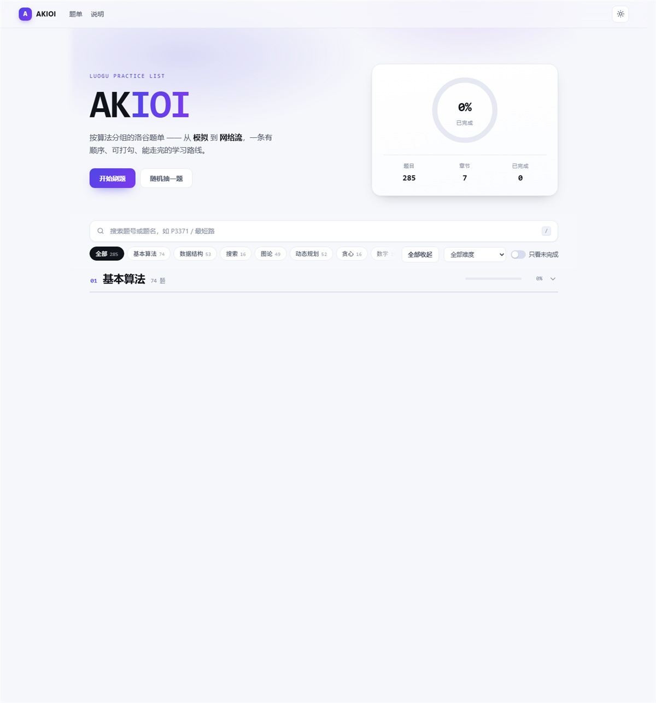

# AKIOI · 洛谷题单

按算法编排的洛谷刷题路线，共 **285** 题，分 **7** 章：**基本算法** · **数据结构** · **搜索** · **图论** · **动态规划** · **贪心** · **数学**。

经典题目参考《算法竞赛进阶指南》、AcWing 算法基础课 / 提高课与洛谷《深入浅出》，再按算法重新编排。每一章都从入门铺到省选——「算法基础」不等于简单。

在线访问：[cuberxl.github.io/AKIOI](https://cuberxl.github.io/AKIOI/)



## 章节总览

| # | 章 | 节 | 题数 | 难度跨度 |
| :-: | :-- | :-- | :-: | :-- |
| 1 | **基本算法** | 基本算法 | 74 | 入门 → 省选/NOI− |
| 2 | **数据结构** | 数据结构、数据结构进阶 | 53 | 普及− → 省选/NOI− |
| 3 | **搜索** | 搜索、搜索进阶 | 16 | 普及− → 提高 |
| 4 | **图论** | 图论、图论进阶 | 49 | 普及 → 省选/NOI− |
| 5 | **动态规划** | 动态规划、动态规划进阶 | 52 | 普及− → 提高+/省选− |
| 6 | **贪心** | 贪心 | 16 | 普及− → 提高 |
| 7 | **数学** | 数学 | 25 | 普及− → 提高 |

## 难度分布

| 难度 | 题数 | |
| :-- | :-: | :-- |
| 暂无评定 | 0 |  |
| 入门 | 4 | █ |
| 普及− | 65 | ████████████████ |
| 普及 | 79 | ████████████████████ |
| 普及+/提高− | 70 | ██████████████████ |
| 提高 | 43 | ███████████ |
| 提高+/省选− | 19 | █████ |
| 省选/NOI− | 5 | █ |
| NOI/NOI+/CTSC | 0 |  |

## 章节明细

### 1. 基本算法（74 题）

**模拟**（13 题）

- [P1001 A+B Problem](https://www.luogu.com.cn/problem/P1001) · 入门
- [P1046 [NOIP 2005 普及组] 陶陶摘苹果](https://www.luogu.com.cn/problem/P1046) · 入门
- [P1047 [NOIP 2005 普及组] 校门外的树](https://www.luogu.com.cn/problem/P1047) · 入门
- [P2670 [NOIP 2015 普及组] 扫雷游戏](https://www.luogu.com.cn/problem/P2670) · 入门
- [P1067 [NOIP 2009 普及组] 多项式输出](https://www.luogu.com.cn/problem/P1067) · 普及−
- [P1563 [NOIP 2016 提高组] 玩具谜题](https://www.luogu.com.cn/problem/P1563) · 普及−
- [P1328 [NOIP 2014 提高组] 生活大爆炸版石头剪刀布](https://www.luogu.com.cn/problem/P1328) · 普及−
- [P1098 [NOIP 2007 提高组] 字符串的展开](https://www.luogu.com.cn/problem/P1098) · 普及−
- [P4924 [1007] 魔法少女小Scarlet](https://www.luogu.com.cn/problem/P4924) · 普及−
- [P1022 [NOIP 2000 普及组] 计算器的改良](https://www.luogu.com.cn/problem/P1022) · 普及
- [P1518 [USACO2.4] 两只塔姆沃斯牛 The Tamworth Two](https://www.luogu.com.cn/problem/P1518) · 普及
- [P3952 [NOIP 2017 提高组] 时间复杂度](https://www.luogu.com.cn/problem/P3952) · 普及+/提高−
- [P1315 [NOIP 2011 提高组] 观光公交](https://www.luogu.com.cn/problem/P1315) · 提高

**枚举**（11 题）

- [P1008 [NOIP 1998 普及组] 三连击](https://www.luogu.com.cn/problem/P1008) · 普及−
- [P1036 [NOIP 2002 普及组] 选数](https://www.luogu.com.cn/problem/P1036) · 普及−
- [P1706 全排列问题](https://www.luogu.com.cn/problem/P1706) · 普及−
- [P2089 烤鸡](https://www.luogu.com.cn/problem/P2089) · 普及−
- [P1149 [NOIP 2008 提高组] 火柴棒等式](https://www.luogu.com.cn/problem/P1149) · 普及−
- [P2241 统计方形（数据加强版）](https://www.luogu.com.cn/problem/P2241) · 普及−
- [P1217 [USACO1.5] 回文质数 Prime Palindromes](https://www.luogu.com.cn/problem/P1217) · 普及−
- [P1157 组合的输出](https://www.luogu.com.cn/problem/P1157) · 普及−
- [P3799 小 Y 拼木棒](https://www.luogu.com.cn/problem/P3799) · 普及
- [P1311 [NOIP 2011 提高组] 选择客栈](https://www.luogu.com.cn/problem/P1311) · 普及
- [P2119 [NOIP 2016 普及组] 魔法阵](https://www.luogu.com.cn/problem/P2119) · 普及+/提高−

**排序**（10 题）

- [P1177 【模板】排序](https://www.luogu.com.cn/problem/P1177) · 普及−
- [P1059 [NOIP 2006 普及组] 明明的随机数](https://www.luogu.com.cn/problem/P1059) · 普及−
- [P1068 [NOIP 2009 普及组] 分数线划定](https://www.luogu.com.cn/problem/P1068) · 普及−
- [P1093 [NOIP 2007 普及组] 奖学金](https://www.luogu.com.cn/problem/P1093) · 普及−
- [P1104 生日](https://www.luogu.com.cn/problem/P1104) · 普及−
- [P1923 【深基9.例4】求第 k 小的数](https://www.luogu.com.cn/problem/P1923) · 普及−
- [P1309 [NOIP 2011 普及组] 瑞士轮](https://www.luogu.com.cn/problem/P1309) · 普及
- [P1774 最接近神的人](https://www.luogu.com.cn/problem/P1774) · 普及
- [P5149 会议座位](https://www.luogu.com.cn/problem/P5149) · 普及
- [P1012 [NOIP 1998 提高组] 拼数](https://www.luogu.com.cn/problem/P1012) · 普及+/提高−

**二分**（13 题）

- [P2249 【深基13.例1】查找](https://www.luogu.com.cn/problem/P2249) · 普及−
- [P1102 A-B 数对](https://www.luogu.com.cn/problem/P1102) · 普及−
- [P1873 [COCI 2011/2012 #5] EKO / 砍树](https://www.luogu.com.cn/problem/P1873) · 普及−
- [P1024 [NOIP 2001 提高组] 一元三次方程求解](https://www.luogu.com.cn/problem/P1024) · 普及−
- [P1678 烦恼的高考志愿](https://www.luogu.com.cn/problem/P1678) · 普及−
- [P1182 数列分段 Section II](https://www.luogu.com.cn/problem/P1182) · 普及
- [P2678 [NOIP 2015 提高组] 跳石头](https://www.luogu.com.cn/problem/P2678) · 普及
- [P2440 木材加工](https://www.luogu.com.cn/problem/P2440) · 普及
- [P1083 [NOIP 2012 提高组] 借教室](https://www.luogu.com.cn/problem/P1083) · 普及
- [P1902 刺杀大使](https://www.luogu.com.cn/problem/P1902) · 普及
- [P1314 [NOIP 2011 提高组] 聪明的质监员](https://www.luogu.com.cn/problem/P1314) · 普及
- [P3743 小鸟的设备](https://www.luogu.com.cn/problem/P3743) · 普及
- [P3957 [NOIP 2017 普及组] 跳房子](https://www.luogu.com.cn/problem/P3957) · 提高

**前缀和与差分**（4 题）

- [P3397 地毯](https://www.luogu.com.cn/problem/P3397) · 普及−
- [P3406 海底高铁](https://www.luogu.com.cn/problem/P3406) · 普及
- [P2879 [USACO07JAN] Tallest Cow S](https://www.luogu.com.cn/problem/P2879) · 普及
- [P2280 [HNOI2003] 激光炸弹](https://www.luogu.com.cn/problem/P2280) · 普及

**递推与递归**（10 题）

- [P1028 [NOIP 2001 普及组] 数的计算](https://www.luogu.com.cn/problem/P1028) · 普及−
- [P1255 数楼梯](https://www.luogu.com.cn/problem/P1255) · 普及−
- [P1464 [PacNW 1999] Function](https://www.luogu.com.cn/problem/P1464) · 普及−
- [P1044 [NOIP 2003 普及组] 栈](https://www.luogu.com.cn/problem/P1044) · 普及−
- [P1192 台阶问题](https://www.luogu.com.cn/problem/P1192) · 普及−
- [P1030 [NOIP 2001 普及组] 求先序排列](https://www.luogu.com.cn/problem/P1030) · 普及−
- [P1010 [NOIP 1998 普及组] 幂次方](https://www.luogu.com.cn/problem/P1010) · 普及−
- [P1025 [NOIP 2001 提高组] 数的划分](https://www.luogu.com.cn/problem/P1025) · 普及
- [P1259 黑白棋子的移动](https://www.luogu.com.cn/problem/P1259) · 普及
- [P1228 地毯填补问题](https://www.luogu.com.cn/problem/P1228) · 普及

**高精度**（6 题）

- [P1601 高精度加法](https://www.luogu.com.cn/problem/P1601) · 普及−
- [P1303 A*B Problem](https://www.luogu.com.cn/problem/P1303) · 普及−
- [P2142 高精度减法](https://www.luogu.com.cn/problem/P2142) · 普及−
- [P1009 [NOIP 1998 普及组] 阶乘之和](https://www.luogu.com.cn/problem/P1009) · 普及−
- [P1480 A/B Problem（高精度除法Ⅰ）](https://www.luogu.com.cn/problem/P1480) · 普及−
- [P2152 [SDOI2009] SuperGCD](https://www.luogu.com.cn/problem/P2152) · 提高

**位运算**（7 题）

- [P1100 高低位交换](https://www.luogu.com.cn/problem/P1100) · 普及−
- [P2114 [NOI2014] 起床困难综合症](https://www.luogu.com.cn/problem/P2114) · 普及+/提高−
- [P4310 绝世好题](https://www.luogu.com.cn/problem/P4310) · 普及+/提高−
- [P3812 【模板】线性基](https://www.luogu.com.cn/problem/P3812) · 提高
- [P4301 [CQOI2013] 新Nim游戏](https://www.luogu.com.cn/problem/P4301) · 提高+/省选−
- [P4570 [BJWC2011] 元素](https://www.luogu.com.cn/problem/P4570) · 提高+/省选−
- [P3292 [SCOI2016] 幸运数字](https://www.luogu.com.cn/problem/P3292) · 省选/NOI−

### 2. 数据结构（53 题）

**栈、队列与堆**（14 题）

- [P3378 【模板】堆](https://www.luogu.com.cn/problem/P3378) · 普及
- [P1886 【模板】单调队列 / 滑动窗口](https://www.luogu.com.cn/problem/P1886) · 普及
- [P1440 求m区间内的最小值](https://www.luogu.com.cn/problem/P1440) · 普及
- [P5788 【模板】单调栈](https://www.luogu.com.cn/problem/P5788) · 普及
- [P1901 发射站](https://www.luogu.com.cn/problem/P1901) · 普及
- [P1160 队列安排](https://www.luogu.com.cn/problem/P1160) · 普及
- [P2058 [NOIP 2016 普及组] 海港](https://www.luogu.com.cn/problem/P2058) · 普及
- [P1168 中位数](https://www.luogu.com.cn/problem/P1168) · 普及
- [P2278 [HNOI2003] 操作系统](https://www.luogu.com.cn/problem/P2278) · 普及
- [P1714 切蛋糕](https://www.luogu.com.cn/problem/P1714) · 普及
- [P1631 序列合并](https://www.luogu.com.cn/problem/P1631) · 普及+/提高−
- [P2168 [NOI2015] 荷马史诗](https://www.luogu.com.cn/problem/P2168) · 提高
- [P2827 [NOIP 2016 提高组] 蚯蚓](https://www.luogu.com.cn/problem/P2827) · 提高
- [P2048 [NOI2010] 超级钢琴](https://www.luogu.com.cn/problem/P2048) · 省选/NOI−

**树状数组与线段树**（16 题）

- [P1908 逆序对](https://www.luogu.com.cn/problem/P1908) · 普及
- [P2880 [USACO07JAN] Balanced Lineup G](https://www.luogu.com.cn/problem/P2880) · 普及
- [P3374 【模板】树状数组 1](https://www.luogu.com.cn/problem/P3374) · 普及+/提高−
- [P3368 【模板】树状数组 2](https://www.luogu.com.cn/problem/P3368) · 普及+/提高−
- [P3372 【模板】线段树 1](https://www.luogu.com.cn/problem/P3372) · 普及+/提高−
- [P3373 【模板】线段树 2](https://www.luogu.com.cn/problem/P3373) · 普及+/提高−
- [P1198 [JSOI2008] 最大数](https://www.luogu.com.cn/problem/P1198) · 普及+/提高−
- [P4552 [Poetize6] IncDec Sequence](https://www.luogu.com.cn/problem/P4552) · 普及+/提高−
- [P2023 [AHOI2009] 维护序列](https://www.luogu.com.cn/problem/P2023) · 普及+/提高−
- [P1438 无聊的数列](https://www.luogu.com.cn/problem/P1438) · 普及+/提高−
- [P1966 [NOIP 2013 提高组] 火柴排队](https://www.luogu.com.cn/problem/P1966) · 提高
- [P4145 上帝造题的七分钟 2 / 花神游历各国](https://www.luogu.com.cn/problem/P4145) · 提高
- [P2572 [SCOI2010] 序列操作](https://www.luogu.com.cn/problem/P2572) · 提高
- [P1471 方差](https://www.luogu.com.cn/problem/P1471) · 提高
- [P4513 小白逛公园](https://www.luogu.com.cn/problem/P4513) · 提高
- [P4198 楼房重建](https://www.luogu.com.cn/problem/P4198) · 提高+/省选−

**字符串**（11 题）

- [P3370 【模板】字符串哈希](https://www.luogu.com.cn/problem/P3370) · 普及−
- [P3375 【模板】KMP](https://www.luogu.com.cn/problem/P3375) · 普及+/提高−
- [P4391 [BalticOI 2009] Radio Transmission 无线传输](https://www.luogu.com.cn/problem/P4391) · 普及+/提高−
- [P3805 【模板】Manacher](https://www.luogu.com.cn/problem/P3805) · 提高
- [P2375 [NOI2014] 动物园](https://www.luogu.com.cn/problem/P2375) · 提高
- [P3435 [POI 2006] OKR-Periods of Words](https://www.luogu.com.cn/problem/P3435) · 提高
- [P5410 【模板】扩展 KMP / exKMP（Z 函数）](https://www.luogu.com.cn/problem/P5410) · 提高+/省选−
- [P3808 AC 自动机（简单版）](https://www.luogu.com.cn/problem/P3808) · 提高+/省选−
- [P2444 [POI 2000 R1] 病毒](https://www.luogu.com.cn/problem/P2444) · 提高+/省选−
- [P3763 [TJOI2017] DNA](https://www.luogu.com.cn/problem/P3763) · 提高+/省选−
- [P3809 【模板】后缀排序（SA）](https://www.luogu.com.cn/problem/P3809) · 提高+/省选−

#### 数据结构进阶

**Trie 与平衡树**（7 题）

- [P2234 [HNOI2002] 营业额统计](https://www.luogu.com.cn/problem/P2234) · 普及−
- [P8306 【模板】字典树 / Trie](https://www.luogu.com.cn/problem/P8306) · 普及
- [P2580 于是他错误的点名开始了](https://www.luogu.com.cn/problem/P2580) · 普及
- [P4551 最长异或路径](https://www.luogu.com.cn/problem/P4551) · 普及+/提高−
- [P1486 [NOI2004] 郁闷的出纳员](https://www.luogu.com.cn/problem/P1486) · 提高
- [P3369 【模板】普通平衡树](https://www.luogu.com.cn/problem/P3369) · 提高+/省选−
- [P3391 【模板】文艺平衡树](https://www.luogu.com.cn/problem/P3391) · 提高+/省选−

**进阶数据结构**（5 题）

- [P5490 【模板】扫描线 & 矩形面积并](https://www.luogu.com.cn/problem/P5490) · 提高
- [P3806 【模板】点分治](https://www.luogu.com.cn/problem/P3806) · 提高+/省选−
- [P3919 【模板】可持久化线段树 1（可持久化数组）](https://www.luogu.com.cn/problem/P3919) · 提高+/省选−
- [P3834 【模板】可持久化线段树 2（静态区间第 k 小）](https://www.luogu.com.cn/problem/P3834) · 提高+/省选−
- [P4168 [Violet] 蒲公英](https://www.luogu.com.cn/problem/P4168) · 省选/NOI−

### 3. 搜索（16 题）

**搜索**（11 题）

- [P1605 迷宫](https://www.luogu.com.cn/problem/P1605) · 普及−
- [P1443 马的遍历](https://www.luogu.com.cn/problem/P1443) · 普及−
- [P1596 [USACO10OCT] Lake Counting S](https://www.luogu.com.cn/problem/P1596) · 普及−
- [P2392 kkksc03 考前临时抱佛脚](https://www.luogu.com.cn/problem/P2392) · 普及−
- [P1219 [USACO1.5] 八皇后 Checker Challenge](https://www.luogu.com.cn/problem/P1219) · 普及
- [P1019 [NOIP 2000 提高组] 单词接龙（疑似错题）](https://www.luogu.com.cn/problem/P1019) · 普及
- [P1135 奇怪的电梯](https://www.luogu.com.cn/problem/P1135) · 普及
- [P2895 [USACO08FEB] Meteor Shower S](https://www.luogu.com.cn/problem/P2895) · 普及
- [P1434 [SHOI2002] 滑雪](https://www.luogu.com.cn/problem/P1434) · 普及
- [P1238 走迷宫](https://www.luogu.com.cn/problem/P1238) · 普及
- [P3956 [NOIP 2017 普及组] 棋盘](https://www.luogu.com.cn/problem/P3956) · 普及+/提高−

#### 搜索进阶

**剪枝与迭代加深**（5 题）

- [P1379 八数码难题](https://www.luogu.com.cn/problem/P1379) · 普及+/提高−
- [P1731 [NOI1999] 生日蛋糕](https://www.luogu.com.cn/problem/P1731) · 普及+/提高−
- [P1120 [CERC 1995] 小木棍](https://www.luogu.com.cn/problem/P1120) · 提高
- [P2324 [SCOI2005] 骑士精神](https://www.luogu.com.cn/problem/P2324) · 提高
- [P1074 [NOIP 2009 提高组] 靶形数独](https://www.luogu.com.cn/problem/P1074) · 提高

### 4. 图论（49 题）

**最短路**（12 题）

- [P3371 【模板】单源最短路径（弱化版）](https://www.luogu.com.cn/problem/P3371) · 普及
- [P4779 【模板】单源最短路径（标准版）](https://www.luogu.com.cn/problem/P4779) · 普及
- [P1629 邮递员送信](https://www.luogu.com.cn/problem/P1629) · 普及
- [P3385 【模板】负环](https://www.luogu.com.cn/problem/P3385) · 普及
- [P1144 最短路计数](https://www.luogu.com.cn/problem/P1144) · 普及+/提高−
- [P1462 通往奥格瑞玛的道路](https://www.luogu.com.cn/problem/P1462) · 普及+/提高−
- [P1119 灾后重建](https://www.luogu.com.cn/problem/P1119) · 普及+/提高−
- [P1608 路径统计](https://www.luogu.com.cn/problem/P1608) · 普及+/提高−
- [P4568 [JLOI2011] 飞行路线](https://www.luogu.com.cn/problem/P4568) · 普及+/提高−
- [P1073 [NOIP 2009 提高组] 最优贸易](https://www.luogu.com.cn/problem/P1073) · 普及+/提高−
- [P5960 【模板】差分约束](https://www.luogu.com.cn/problem/P5960) · 普及+/提高−
- [P5304 [GXOI/GZOI2019] 旅行者](https://www.luogu.com.cn/problem/P5304) · 提高

**生成树与并查集**（12 题）

- [P3366 【模板】最小生成树](https://www.luogu.com.cn/problem/P3366) · 普及
- [P3367 【模板】并查集](https://www.luogu.com.cn/problem/P3367) · 普及
- [P1551 亲戚](https://www.luogu.com.cn/problem/P1551) · 普及
- [P1111 修复公路](https://www.luogu.com.cn/problem/P1111) · 普及
- [P2330 [SCOI2005] 繁忙的都市](https://www.luogu.com.cn/problem/P2330) · 普及
- [P1547 [USACO05MAR] Out of Hay S](https://www.luogu.com.cn/problem/P1547) · 普及
- [P1525 [NOIP 2010 提高组] 关押罪犯](https://www.luogu.com.cn/problem/P1525) · 普及+/提高−
- [P2024 [NOI2001] 食物链](https://www.luogu.com.cn/problem/P2024) · 普及+/提高−
- [P1892 [BalticOI 2003] 团伙 (Day 2)](https://www.luogu.com.cn/problem/P1892) · 普及+/提高−
- [P4047 [JSOI2010] 部落划分](https://www.luogu.com.cn/problem/P4047) · 普及+/提高−
- [P1967 [NOIP 2013 提高组] 货车运输](https://www.luogu.com.cn/problem/P1967) · 提高
- [P4180 [BJWC2010] 严格次小生成树](https://www.luogu.com.cn/problem/P4180) · 提高+/省选−

#### 图论进阶

**拓扑排序与树**（13 题）

- [P4017 最大食物链计数](https://www.luogu.com.cn/problem/P4017) · 普及
- [P1113 [USACO02FEB] 杂务](https://www.luogu.com.cn/problem/P1113) · 普及
- [P1807 最长路](https://www.luogu.com.cn/problem/P1807) · 普及
- [P3379 【模板】最近公共祖先（LCA）](https://www.luogu.com.cn/problem/P3379) · 普及
- [P3865 【模板】ST 表 & RMQ 问题](https://www.luogu.com.cn/problem/P3865) · 普及
- [P3916 图的遍历](https://www.luogu.com.cn/problem/P3916) · 普及
- [P5836 [USACO19DEC] Milk Visits S](https://www.luogu.com.cn/problem/P5836) · 普及
- [P1983 [NOIP 2013 普及组] 车站分级](https://www.luogu.com.cn/problem/P1983) · 普及+/提高−
- [P3128 [USACO15DEC] Max Flow P](https://www.luogu.com.cn/problem/P3128) · 普及+/提高−
- [P3258 [JLOI2014] 松鼠的新家](https://www.luogu.com.cn/problem/P3258) · 普及+/提高−
- [P4281 [AHOI2008] 紧急集合 / 聚会](https://www.luogu.com.cn/problem/P4281) · 普及+/提高−
- [P1099 [NOIP 2007 提高组] 树网的核](https://www.luogu.com.cn/problem/P1099) · 提高
- [P3629 [APIO2010] 巡逻](https://www.luogu.com.cn/problem/P3629) · 提高

**连通性与网络流**（12 题）

- [P1330 封锁阳光大学](https://www.luogu.com.cn/problem/P1330) · 普及
- [P3387 【模板】缩点 / 强连通分量](https://www.luogu.com.cn/problem/P3387) · 普及+/提高−
- [P3388 【模板】割点](https://www.luogu.com.cn/problem/P3388) · 普及+/提高−
- [P3386 【模板】二分图最大匹配](https://www.luogu.com.cn/problem/P3386) · 普及+/提高−
- [P2756 飞行员配对方案问题](https://www.luogu.com.cn/problem/P2756) · 普及+/提高−
- [P5058 [ZJOI2004] 嗅探器](https://www.luogu.com.cn/problem/P5058) · 普及+/提高−
- [P1262 [POI 1996 R3] 间谍网络](https://www.luogu.com.cn/problem/P1262) · 普及+/提高−
- [P3225 [ICPC 2011 WF / HNOI2012] 矿场搭建](https://www.luogu.com.cn/problem/P3225) · 提高
- [P3376 【模板】网络最大流](https://www.luogu.com.cn/problem/P3376) · 提高+/省选−
- [P3381 【模板】最小费用最大流](https://www.luogu.com.cn/problem/P3381) · 提高+/省选−
- [P1402 酒店之王](https://www.luogu.com.cn/problem/P1402) · 省选/NOI−
- [P2764 最小路径覆盖问题](https://www.luogu.com.cn/problem/P2764) · 省选/NOI−

### 5. 动态规划（52 题）

**线性 DP**（15 题）

- [P1216 [IOI 1994 / USACO1.5] 数字三角形 Number Triangles](https://www.luogu.com.cn/problem/P1216) · 普及−
- [P1002 [NOIP 2002 普及组] 过河卒](https://www.luogu.com.cn/problem/P1002) · 普及−
- [P1091 [NOIP 2004 提高组] 合唱队形](https://www.luogu.com.cn/problem/P1091) · 普及−
- [P2758 编辑距离](https://www.luogu.com.cn/problem/P2758) · 普及
- [P1095 [NOIP 2007 普及组] 守望者的逃离](https://www.luogu.com.cn/problem/P1095) · 普及
- [P1108 [USACO99FALL] 低价购买](https://www.luogu.com.cn/problem/P1108) · 普及
- [P2513 [HAOI2009] 逆序对数列](https://www.luogu.com.cn/problem/P2513) · 普及
- [P1020 [NOIP 1999 提高组] 导弹拦截](https://www.luogu.com.cn/problem/P1020) · 普及+/提高−
- [P1439 两个排列的最长公共子序列](https://www.luogu.com.cn/problem/P1439) · 普及+/提高−
- [P1541 [NOIP 2010 提高组] 乌龟棋](https://www.luogu.com.cn/problem/P1541) · 普及+/提高−
- [P1052 [NOIP 2005 提高组] 过河](https://www.luogu.com.cn/problem/P1052) · 普及+/提高−
- [P1282 [CEOI 1997] 多米诺骨牌](https://www.luogu.com.cn/problem/P1282) · 普及+/提高−
- [P1868 饥饿的奶牛](https://www.luogu.com.cn/problem/P1868) · 普及+/提高−
- [P2365 [IOI 2002] 任务安排](https://www.luogu.com.cn/problem/P2365) · 普及+/提高−
- [P3287 [SCOI2014] 方伯伯的玉米田](https://www.luogu.com.cn/problem/P3287) · 提高+/省选−

**背包 DP**（14 题）

- [P1048 [NOIP 2005 普及组] 采药](https://www.luogu.com.cn/problem/P1048) · 普及−
- [P1616 疯狂的采药](https://www.luogu.com.cn/problem/P1616) · 普及−
- [P1060 [NOIP 2006 普及组] 开心的金明](https://www.luogu.com.cn/problem/P1060) · 普及−
- [P1164 小 A 点菜](https://www.luogu.com.cn/problem/P1164) · 普及−
- [P2722 [USACO3.1] 总分 Score Inflation](https://www.luogu.com.cn/problem/P2722) · 普及−
- [P2347 [NOIP 1996 提高组] 砝码称重](https://www.luogu.com.cn/problem/P2347) · 普及−
- [P1757 通天之分组背包](https://www.luogu.com.cn/problem/P1757) · 普及−
- [P1877 [HAOI2012] 音量调节](https://www.luogu.com.cn/problem/P1877) · 普及−
- [P1853 [NWERC 2004] 投资的最大效益](https://www.luogu.com.cn/problem/P1853) · 普及
- [P4141 消失之物](https://www.luogu.com.cn/problem/P4141) · 普及
- [P5020 [NOIP 2018 提高组] 货币系统](https://www.luogu.com.cn/problem/P5020) · 普及+/提高−
- [P1417 烹调方案](https://www.luogu.com.cn/problem/P1417) · 普及+/提高−
- [P1776 宝物筛选](https://www.luogu.com.cn/problem/P1776) · 普及+/提高−
- [P1941 [NOIP 2014 提高组] 飞扬的小鸟](https://www.luogu.com.cn/problem/P1941) · 普及+/提高−

**区间 DP**（7 题）

- [P1880 [NOI1995] 石子合并](https://www.luogu.com.cn/problem/P1880) · 普及+/提高−
- [P1063 [NOIP 2006 提高组] 能量项链](https://www.luogu.com.cn/problem/P1063) · 普及+/提高−
- [P1220 关路灯](https://www.luogu.com.cn/problem/P1220) · 普及+/提高−
- [P1430 序列取数](https://www.luogu.com.cn/problem/P1430) · 普及+/提高−
- [P4302 [SCOI2003] 字符串折叠](https://www.luogu.com.cn/problem/P4302) · 普及+/提高−
- [P4170 [CQOI2007] 涂色](https://www.luogu.com.cn/problem/P4170) · 提高+/省选−
- [P7914 [CSP-S 2021] 括号序列](https://www.luogu.com.cn/problem/P7914) · 提高+/省选−

#### 动态规划进阶

**树形 DP**（8 题）

- [P1352 没有上司的舞会](https://www.luogu.com.cn/problem/P1352) · 普及
- [P2016 [SEERC 2000] 战略游戏](https://www.luogu.com.cn/problem/P2016) · 普及
- [P1122 最大子树和](https://www.luogu.com.cn/problem/P1122) · 普及
- [P2014 [CTSC1997] 选课](https://www.luogu.com.cn/problem/P2014) · 普及+/提高−
- [P2015 二叉苹果树](https://www.luogu.com.cn/problem/P2015) · 普及+/提高−
- [P2899 [USACO08JAN] Cell Phone Network G](https://www.luogu.com.cn/problem/P2899) · 普及+/提高−
- [P3174 [HAOI2009] 毛毛虫](https://www.luogu.com.cn/problem/P3174) · 普及+/提高−
- [P2279 [HNOI2003] 消防局的设立](https://www.luogu.com.cn/problem/P2279) · 提高

**状压与数位 DP**（8 题）

- [P2657 [SCOI2009] windy 数](https://www.luogu.com.cn/problem/P2657) · 普及
- [P1879 [USACO06NOV] Corn Fields G](https://www.luogu.com.cn/problem/P1879) · 普及+/提高−
- [P2602 [ZJOI2010] 数字计数](https://www.luogu.com.cn/problem/P2602) · 普及+/提高−
- [P4999 烦人的数学作业](https://www.luogu.com.cn/problem/P4999) · 普及+/提高−
- [P1896 [SCOI2005] 互不侵犯](https://www.luogu.com.cn/problem/P1896) · 提高
- [P2831 [NOIP 2016 提高组] 愤怒的小鸟](https://www.luogu.com.cn/problem/P2831) · 提高
- [P4124 [CQOI2016] 手机号码](https://www.luogu.com.cn/problem/P4124) · 提高
- [P4127 [AHOI2009] 同类分布](https://www.luogu.com.cn/problem/P4127) · 提高

### 6. 贪心（16 题）

**贪心**（16 题）

- [P1223 排队接水](https://www.luogu.com.cn/problem/P1223) · 普及−
- [P1803 凌乱的yyy / 线段覆盖](https://www.luogu.com.cn/problem/P1803) · 普及−
- [P1094 [NOIP 2007 普及组] 纪念品分组](https://www.luogu.com.cn/problem/P1094) · 普及−
- [P1190 [NOIP 2010 普及组] 接水问题](https://www.luogu.com.cn/problem/P1190) · 普及−
- [P2240 【深基12.例1】部分背包问题](https://www.luogu.com.cn/problem/P2240) · 普及−
- [P4995 跳跳！](https://www.luogu.com.cn/problem/P4995) · 普及−
- [P1208 [USACO1.3] 混合牛奶 Mixing Milk](https://www.luogu.com.cn/problem/P1208) · 普及−
- [P1090 [NOIP 2004 提高组] 合并果子](https://www.luogu.com.cn/problem/P1090) · 普及
- [P5019 [NOIP 2018 提高组] 铺设道路](https://www.luogu.com.cn/problem/P5019) · 普及
- [P1106 删数问题](https://www.luogu.com.cn/problem/P1106) · 普及
- [P1650 [ICPC 2004 Shanghai R] 田忌赛马](https://www.luogu.com.cn/problem/P1650) · 普及
- [P1842 [USACO05NOV] 奶牛玩杂技](https://www.luogu.com.cn/problem/P1842) · 普及
- [P1080 [NOIP 2012 提高组] 国王游戏](https://www.luogu.com.cn/problem/P1080) · 提高
- [P2123 皇后游戏](https://www.luogu.com.cn/problem/P2123) · 提高
- [P3619 魔法](https://www.luogu.com.cn/problem/P3619) · 提高
- [P4053 [JSOI2007] 建筑抢修](https://www.luogu.com.cn/problem/P4053) · 提高

### 7. 数学（25 题）

**数论**（13 题）

- [P3383 【模板】线性筛素数](https://www.luogu.com.cn/problem/P3383) · 普及−
- [P1226 【模板】快速幂](https://www.luogu.com.cn/problem/P1226) · 普及−
- [P1075 [NOIP 2012 普及组] 质因数分解](https://www.luogu.com.cn/problem/P1075) · 普及−
- [P3811 【模板】模意义下的乘法逆元](https://www.luogu.com.cn/problem/P3811) · 普及
- [P4549 【模板】裴蜀定理](https://www.luogu.com.cn/problem/P4549) · 普及
- [P1865 A % B Problem](https://www.luogu.com.cn/problem/P1865) · 普及
- [P1082 [NOIP 2012 提高组] 同余方程](https://www.luogu.com.cn/problem/P1082) · 普及+/提高−
- [P1495 【模板】中国剩余定理（CRT）/ 曹冲养猪](https://www.luogu.com.cn/problem/P1495) · 提高
- [P1516 [ZJOI2002] 青蛙的约会](https://www.luogu.com.cn/problem/P1516) · 提高
- [P2158 [SDOI2008] 仪仗队](https://www.luogu.com.cn/problem/P2158) · 提高
- [P3868 [TJOI2009] 猜数字](https://www.luogu.com.cn/problem/P3868) · 提高
- [P4777 【模板】扩展中国剩余定理（EXCRT）](https://www.luogu.com.cn/problem/P4777) · 提高
- [P1463 [POI 2001 R1 / ZJOI2006 / HAOI2007] 反素数](https://www.luogu.com.cn/problem/P1463) · 提高

**组合、矩阵与概率**（12 题）

- [P2822 [NOIP 2016 提高组] 组合数问题](https://www.luogu.com.cn/problem/P2822) · 普及
- [P1313 [NOIP 2011 提高组] 计算系数](https://www.luogu.com.cn/problem/P1313) · 普及
- [P3197 [HNOI2008] 越狱](https://www.luogu.com.cn/problem/P3197) · 普及
- [P3390 【模板】矩阵快速幂](https://www.luogu.com.cn/problem/P3390) · 普及+/提高−
- [P1962 斐波那契数列](https://www.luogu.com.cn/problem/P1962) · 普及+/提高−
- [P2197 【模板】Nim 游戏](https://www.luogu.com.cn/problem/P2197) · 普及+/提高−
- [P4316 绿豆蛙的归宿](https://www.luogu.com.cn/problem/P4316) · 普及+/提高−
- [P4071 [SDOI2016] 排列计数](https://www.luogu.com.cn/problem/P4071) · 普及+/提高−
- [P3807 【模板】卢卡斯定理 / Lucas 定理](https://www.luogu.com.cn/problem/P3807) · 提高
- [P3389 【模板】高斯消元法](https://www.luogu.com.cn/problem/P3389) · 提高
- [P1654 OSU!](https://www.luogu.com.cn/problem/P1654) · 提高
- [P1850 [NOIP 2016 提高组] 换教室](https://www.luogu.com.cn/problem/P1850) · 提高

## 本地预览

纯静态站点，没有任何构建依赖，直接打开即可：

```bash
# 方式一：直接双击 index.html
# 方式二：起一个静态服务器（推荐，避免部分浏览器的 file:// 限制）
python -m http.server 8080
# 然后访问 http://localhost:8080
```

## 功能

- 按章、难度筛选，支持题号 / 题名搜索（快捷键 `/`）
- 打卡后进度保存在浏览器 localStorage，可导出 / 导入 JSON
- 浅色 / 深色主题，移动端适配
- 数据与页面分离：题目在 `data/problems.js`，改题单只改 `tools/source.json` 再重新生成

## 重新生成数据

```bash
# 1. 编辑 tools/source.json（章 → 节 → 主题 → 题号）
# 2. 重新抓取标题与难度（需要能访问洛谷）
#    tools/fetch-metadata.ps1 会写入 tools/meta.json
# 3. 合并生成 data/problems.js 与 README.md
node tools/build.mjs
```

## 部署到 GitHub Pages

1. 仓库 Settings → Pages → Source 选 `Deploy from a branch`，分支 `main`、目录 `/`（根目录）。
2. 稍等一两分钟，访问 `https://<用户名>.github.io/AKIOI/`。

## 版权

题目内容、标题与难度评级归 [洛谷](https://www.luogu.com.cn/) 及各题作者所有，本仓库只做题单编排与学习进度记录。
