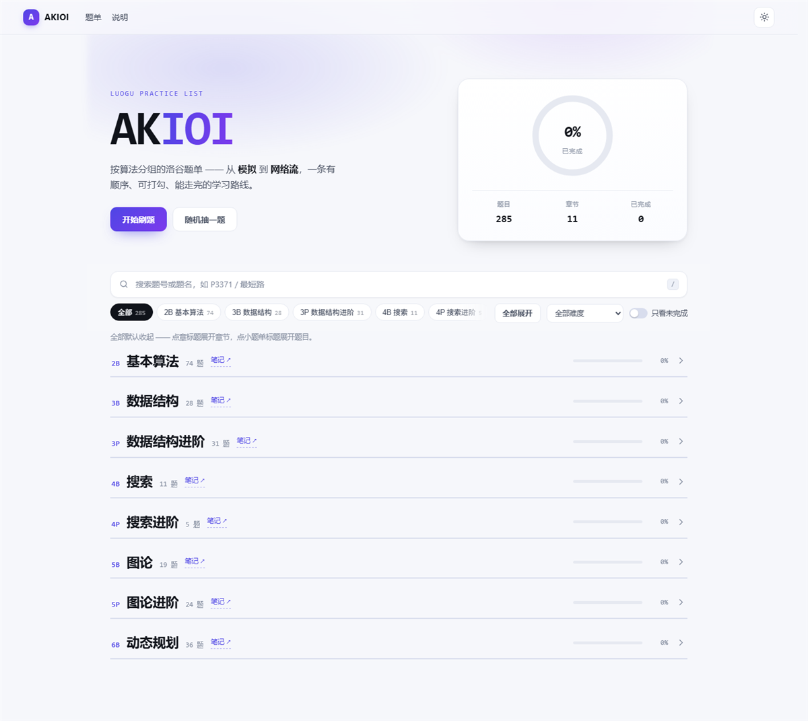

# AKIOI · 洛谷题单

按算法编排的洛谷刷题站，分三块：**专项训练**（11 个 Part、707 题）、**实用工具**、**真题模拟**。

章节编号与 [Coders-Note](https://cuberxl.github.io/Coders-Note/) 的笔记一一对应（B 基础、P 提高），每个 Part 都能直接跳到对应笔记。

经典题目参考《算法竞赛进阶指南》、AcWing 算法基础课 / 提高课与洛谷《深入浅出》，再按算法重新编排。每一章都从入门铺到省选——「算法基础」不等于简单。

在线访问：[cuberxl.github.io/AKIOI](https://cuberxl.github.io/AKIOI/)



## 章节总览

编号与 [Coders-Note](https://cuberxl.github.io/Coders-Note/) 的笔记章节一一对应（B 为基础、P 为提高），每章末尾可直接跳到对应笔记。

| 编号 | 章 | 题数 | 难度跨度 | 笔记 |
| :-: | :-- | :-: | :-- | :-- |
| **2B** | 基本算法 | 211 | 入门 → NOI/NOI+/CTSC | [笔记](https://cuberxl.github.io/Coders-Note/2B-基本算法/) |
| **3B** | 数据结构 | 64 | 入门 → 省选/NOI− | [笔记](https://cuberxl.github.io/Coders-Note/3B-数据结构/) |
| **3P** | 数据结构进阶 | 72 | 普及− → NOI/NOI+/CTSC | [笔记](https://cuberxl.github.io/Coders-Note/3P-数据结构进阶/) |
| **4B** | 搜索 | 24 | 普及− → 普及+/提高− | [笔记](https://cuberxl.github.io/Coders-Note/4B-搜索/) |
| **4P** | 搜索进阶 | 11 | 普及+/提高− → 省选/NOI− | [笔记](https://cuberxl.github.io/Coders-Note/4P-搜索进阶/) |
| **5B** | 图论 | 59 | 普及 → 省选/NOI− | [笔记](https://cuberxl.github.io/Coders-Note/5B-图论/) |
| **5P** | 图论进阶 | 54 | 普及 → 省选/NOI− | [笔记](https://cuberxl.github.io/Coders-Note/5P-图论进阶/) |
| **6B** | 动态规划 | 99 | 普及− → 提高+/省选− | [笔记](https://cuberxl.github.io/Coders-Note/6B-动态规划/) |
| **6P** | 动态规划进阶 | 42 | 普及 → NOI/NOI+/CTSC | [笔记](https://cuberxl.github.io/Coders-Note/6P-动态规划进阶/) |
| **7B** | 贪心 | 46 | 普及− → 省选/NOI− | [笔记](https://cuberxl.github.io/Coders-Note/7B-贪心/) |
| **8B** | 数学 | 25 | 普及− → 提高 | [笔记](https://cuberxl.github.io/Coders-Note/8B-数学/) |

## 难度分布

| 难度 | 题数 | |
| :-- | :-: | :-- |
| 暂无评定 | 0 |  |
| 入门 | 10 | █ |
| 普及− | 137 | ███████████████ |
| 普及 | 179 | ███████████████████ |
| 普及+/提高− | 186 | ████████████████████ |
| 提高 | 126 | ██████████████ |
| 提高+/省选− | 35 | ████ |
| 省选/NOI− | 29 | ███ |
| NOI/NOI+/CTSC | 5 | █ |

## 章节明细

### 2B 基本算法（211 题 · [对应笔记](https://cuberxl.github.io/Coders-Note/2B-基本算法/)）

**模拟**（55 题 · [笔记](https://cuberxl.github.io/Coders-Note/2B-基本算法/)）

- [P1001 A+B Problem](https://www.luogu.com.cn/problem/P1001) · 入门
- [P1046 [NOIP 2005 普及组] 陶陶摘苹果](https://www.luogu.com.cn/problem/P1046) · 入门
- [P1047 [NOIP 2005 普及组] 校门外的树](https://www.luogu.com.cn/problem/P1047) · 入门
- [P2670 [NOIP 2015 普及组] 扫雷游戏](https://www.luogu.com.cn/problem/P2670) · 入门
- [P1980 [NOIP 2013 普及组] 计数问题](https://www.luogu.com.cn/problem/P1980) · 入门
- [P1307 [NOIP 2011 普及组] 数字反转](https://www.luogu.com.cn/problem/P1307) · 入门
- [P1179 [NOIP 2010 普及组] 数字统计](https://www.luogu.com.cn/problem/P1179) · 入门
- [P1067 [NOIP 2009 普及组] 多项式输出](https://www.luogu.com.cn/problem/P1067) · 普及−
- [P1563 [NOIP 2016 提高组] 玩具谜题](https://www.luogu.com.cn/problem/P1563) · 普及−
- [P1328 [NOIP 2014 提高组] 生活大爆炸版石头剪刀布](https://www.luogu.com.cn/problem/P1328) · 普及−
- [P1098 [NOIP 2007 提高组] 字符串的展开](https://www.luogu.com.cn/problem/P1098) · 普及−
- [P4924 [1007] 魔法少女小Scarlet](https://www.luogu.com.cn/problem/P4924) · 普及−
- [P7072 [CSP-J 2020] 直播获奖](https://www.luogu.com.cn/problem/P7072) · 普及−
- [P2141 [NOIP 2014 普及组] 珠心算测验](https://www.luogu.com.cn/problem/P2141) · 普及−
- [P5661 [CSP-J 2019] 公交换乘](https://www.luogu.com.cn/problem/P5661) · 普及−
- [P11228 [CSP-J 2024] 地图探险](https://www.luogu.com.cn/problem/P11228) · 普及−
- [P14358 [CSP-J 2025] 座位](https://www.luogu.com.cn/problem/P14358) · 普及−
- [P9748 [CSP-J 2023] 小苹果](https://www.luogu.com.cn/problem/P9748) · 普及−
- [P2010 [NOIP 2016 普及组] 回文日期](https://www.luogu.com.cn/problem/P2010) · 普及−
- [P5016 [NOIP 2018 普及组] 龙虎斗](https://www.luogu.com.cn/problem/P5016) · 普及−
- [P1003 [NOIP 2011 提高组] 铺地毯](https://www.luogu.com.cn/problem/P1003) · 普及−
- [P2615 [NOIP 2015 提高组] 神奇的幻方](https://www.luogu.com.cn/problem/P2615) · 普及−
- [P1022 [NOIP 2000 普及组] 计算器的改良](https://www.luogu.com.cn/problem/P1022) · 普及
- [P1518 [USACO2.4] 两只塔姆沃斯牛 The Tamworth Two](https://www.luogu.com.cn/problem/P1518) · 普及
- [P7911 [CSP-J 2021] 网络连接](https://www.luogu.com.cn/problem/P7911) · 普及
- [P1076 [NOIP 2012 普及组] 寻宝](https://www.luogu.com.cn/problem/P1076) · 普及
- [P2239 [NOIP 2014 普及组] 螺旋矩阵](https://www.luogu.com.cn/problem/P2239) · 普及
- [P9750 [CSP-J 2023] 一元二次方程](https://www.luogu.com.cn/problem/P9750) · 普及
- [P1058 [NOIP 2008 普及组] 立体图](https://www.luogu.com.cn/problem/P1058) · 普及
- [P1061 [NOIP 2006 普及组] Jam 的计数法](https://www.luogu.com.cn/problem/P1061) · 普及
- [P1158 [NOIP 2010 普及组] 导弹拦截](https://www.luogu.com.cn/problem/P1158) · 普及
- [P1016 [NOIP 1999 普及组/提高组] 旅行家的预算](https://www.luogu.com.cn/problem/P1016) · 普及
- [P3952 [NOIP 2017 提高组] 时间复杂度](https://www.luogu.com.cn/problem/P3952) · 普及+/提高−
- [P7912 [CSP-J 2021] 小熊的果篮](https://www.luogu.com.cn/problem/P7912) · 普及+/提高−
- [P5763 [NOI1999] 内存分配](https://www.luogu.com.cn/problem/P5763) · 普及+/提高−
- [P7073 [CSP-J 2020] 表达式](https://www.luogu.com.cn/problem/P7073) · 普及+/提高−
- [P7075 [CSP-S 2020] 儒略日](https://www.luogu.com.cn/problem/P7075) · 普及+/提高−
- [P7913 [CSP-S 2021] 廊桥分配](https://www.luogu.com.cn/problem/P7913) · 普及+/提高−
- [P8815 [CSP-J 2022] 逻辑表达式](https://www.luogu.com.cn/problem/P8815) · 普及+/提高−
- [P11232 [CSP-S 2024] 超速检测](https://www.luogu.com.cn/problem/P11232) · 普及+/提高−
- [P1315 [NOIP 2011 提高组] 观光公交](https://www.luogu.com.cn/problem/P1315) · 提高
- [P1039 [NOIP 2003 提高组] 侦探推理](https://www.luogu.com.cn/problem/P1039) · 提高
- [P2668 [NOIP 2015 提高组] 斗地主](https://www.luogu.com.cn/problem/P2668) · 提高
- [P1050 [NOIP 2005 普及组] 循环](https://www.luogu.com.cn/problem/P1050) · 提高
- [P1054 [NOIP 2005 提高组] 等价表达式](https://www.luogu.com.cn/problem/P1054) · 提高
- [P1448 [NOI1998] 围巾裁剪](https://www.luogu.com.cn/problem/P1448) · 提高
- [P5698 [CTSC1998] 算法复杂度](https://www.luogu.com.cn/problem/P5698) · 提高
- [P7366 [CTSC2002] 月亮森林](https://www.luogu.com.cn/problem/P7366) · 提高
- [P9754 [CSP-S 2023] 结构体](https://www.luogu.com.cn/problem/P9754) · 提高+/省选−
- [P7196 [CTSC2002] 灭鼠行动](https://www.luogu.com.cn/problem/P7196) · 省选/NOI−
- [P4997 不围棋](https://www.luogu.com.cn/problem/P4997) · 省选/NOI−
- [P3695 CYaRon!语](https://www.luogu.com.cn/problem/P3695) · 省选/NOI−
- [P17091 『lnOI-R1』三十四万一千七百九十九](https://www.luogu.com.cn/problem/P17091) · 省选/NOI−
- [P2482 [SDOI2010] 猪国杀](https://www.luogu.com.cn/problem/P2482) · 省选/NOI−
- [P9499 「RiOI-2」change](https://www.luogu.com.cn/problem/P9499) · NOI/NOI+/CTSC

**枚举**（23 题 · [笔记](https://cuberxl.github.io/Coders-Note/2B-基本算法/)）

- [P1008 [NOIP 1998 普及组] 三连击](https://www.luogu.com.cn/problem/P1008) · 普及−
- [P1036 [NOIP 2002 普及组] 选数](https://www.luogu.com.cn/problem/P1036) · 普及−
- [P1706 全排列问题](https://www.luogu.com.cn/problem/P1706) · 普及−
- [P2089 烤鸡](https://www.luogu.com.cn/problem/P2089) · 普及−
- [P1149 [NOIP 2008 提高组] 火柴棒等式](https://www.luogu.com.cn/problem/P1149) · 普及−
- [P2241 统计方形（数据加强版）](https://www.luogu.com.cn/problem/P2241) · 普及−
- [P1217 [USACO1.5] 回文质数 Prime Palindromes](https://www.luogu.com.cn/problem/P1217) · 普及−
- [P1157 组合的输出](https://www.luogu.com.cn/problem/P1157) · 普及−
- [P1618 三连击（升级版）](https://www.luogu.com.cn/problem/P1618) · 普及−
- [P1088 [NOIP 2004 普及组] 火星人](https://www.luogu.com.cn/problem/P1088) · 普及−
- [P3392 涂条纹](https://www.luogu.com.cn/problem/P3392) · 普及−
- [P3654 First Step (ファーストステップ)](https://www.luogu.com.cn/problem/P3654) · 普及−
- [P2036 [COCI 2008/2009 #2] PERKET](https://www.luogu.com.cn/problem/P2036) · 普及−
- [P1014 [NOIP 1999 普及组] Cantor 表](https://www.luogu.com.cn/problem/P1014) · 普及−
- [P1029 [NOIP 2001 普及组] 最大公约数和最小公倍数问题](https://www.luogu.com.cn/problem/P1029) · 普及−
- [P1072 [NOIP 2009 提高组] Hankson 的趣味题](https://www.luogu.com.cn/problem/P1072) · 普及−
- [P3799 小 Y 拼木棒](https://www.luogu.com.cn/problem/P3799) · 普及
- [P1311 [NOIP 2011 提高组] 选择客栈](https://www.luogu.com.cn/problem/P1311) · 普及
- [P1023 [NOIP 2000 普及组] 税收与补贴问题](https://www.luogu.com.cn/problem/P1023) · 普及
- [P2119 [NOIP 2016 普及组] 魔法阵](https://www.luogu.com.cn/problem/P2119) · 普及+/提高−
- [P1013 [NOIP 1998 提高组] 进制位](https://www.luogu.com.cn/problem/P1013) · 普及+/提高−
- [P1026 [NOIP 2001 提高组] 统计单词个数](https://www.luogu.com.cn/problem/P1026) · 普及+/提高−
- [P2315 [HNOI2005] 数三角形](https://www.luogu.com.cn/problem/P2315) · 普及+/提高−

**排序**（27 题 · [笔记](https://cuberxl.github.io/Coders-Note/2B-基本算法/2B.1-排序算法)）

- [P1152 欢乐的跳](https://www.luogu.com.cn/problem/P1152) · 入门
- [P1177 【模板】排序](https://www.luogu.com.cn/problem/P1177) · 普及−
- [P1059 [NOIP 2006 普及组] 明明的随机数](https://www.luogu.com.cn/problem/P1059) · 普及−
- [P1068 [NOIP 2009 普及组] 分数线划定](https://www.luogu.com.cn/problem/P1068) · 普及−
- [P1093 [NOIP 2007 普及组] 奖学金](https://www.luogu.com.cn/problem/P1093) · 普及−
- [P1104 生日](https://www.luogu.com.cn/problem/P1104) · 普及−
- [P1923 【深基9.例4】求第 k 小的数](https://www.luogu.com.cn/problem/P1923) · 普及−
- [P1271 【深基9.例1】选举学生会](https://www.luogu.com.cn/problem/P1271) · 普及−
- [P1781 宇宙总统](https://www.luogu.com.cn/problem/P1781) · 普及−
- [P2676 [USACO07DEC] Bookshelf B](https://www.luogu.com.cn/problem/P2676) · 普及−
- [P1116 车厢重组](https://www.luogu.com.cn/problem/P1116) · 普及−
- [P5143 攀爬者](https://www.luogu.com.cn/problem/P5143) · 普及−
- [P1309 [NOIP 2011 普及组] 瑞士轮](https://www.luogu.com.cn/problem/P1309) · 普及
- [P1774 最接近神的人](https://www.luogu.com.cn/problem/P1774) · 普及
- [P5149 会议座位](https://www.luogu.com.cn/problem/P5149) · 普及
- [P1056 [NOIP 2008 普及组] 排座椅](https://www.luogu.com.cn/problem/P1056) · 普及
- [P1227 [JSOI2008] 完美的对称](https://www.luogu.com.cn/problem/P1227) · 普及
- [P1627 [CQOI2009] 中位数](https://www.luogu.com.cn/problem/P1627) · 普及
- [P2434 [SDOI2005] 区间](https://www.luogu.com.cn/problem/P2434) · 普及
- [P3871 [TJOI2010] 中位数](https://www.luogu.com.cn/problem/P3871) · 普及
- [P5682 [CSP-J 2019 江西] 次大值](https://www.luogu.com.cn/problem/P5682) · 普及
- [P7910 [CSP-J 2021] 插入排序](https://www.luogu.com.cn/problem/P7910) · 普及
- [P1012 [NOIP 1998 提高组] 拼数](https://www.luogu.com.cn/problem/P1012) · 普及+/提高−
- [P2671 [NOIP 2015 普及组] 求和](https://www.luogu.com.cn/problem/P2671) · 普及+/提高−
- [P3243 [HNOI2015] 菜肴制作](https://www.luogu.com.cn/problem/P3243) · 普及+/提高−
- [P4165 [SCOI2007] 组队](https://www.luogu.com.cn/problem/P4165) · 普及+/提高−
- [P6033 [NOIP 2004 提高组] 合并果子 加强版](https://www.luogu.com.cn/problem/P6033) · 普及+/提高−

**二分**（39 题 · [笔记](https://cuberxl.github.io/Coders-Note/2B-基本算法/2B.2-二分查找)）

- [P2249 【深基13.例1】查找](https://www.luogu.com.cn/problem/P2249) · 普及−
- [P1102 A-B 数对](https://www.luogu.com.cn/problem/P1102) · 普及−
- [P1873 [COCI 2011/2012 #5] EKO / 砍树](https://www.luogu.com.cn/problem/P1873) · 普及−
- [P1024 [NOIP 2001 提高组] 一元三次方程求解](https://www.luogu.com.cn/problem/P1024) · 普及−
- [P1678 烦恼的高考志愿](https://www.luogu.com.cn/problem/P1678) · 普及−
- [P1258 小车问题](https://www.luogu.com.cn/problem/P1258) · 普及−
- [P1824 [USACO05FEB] 进击的奶牛 Aggressive Cows G](https://www.luogu.com.cn/problem/P1824) · 普及−
- [P1163 银行贷款](https://www.luogu.com.cn/problem/P1163) · 普及−
- [P1182 数列分段 Section II](https://www.luogu.com.cn/problem/P1182) · 普及
- [P2678 [NOIP 2015 提高组] 跳石头](https://www.luogu.com.cn/problem/P2678) · 普及
- [P2440 木材加工](https://www.luogu.com.cn/problem/P2440) · 普及
- [P1083 [NOIP 2012 提高组] 借教室](https://www.luogu.com.cn/problem/P1083) · 普及
- [P1902 刺杀大使](https://www.luogu.com.cn/problem/P1902) · 普及
- [P1314 [NOIP 2011 提高组] 聪明的质监员](https://www.luogu.com.cn/problem/P1314) · 普及
- [P3743 小鸟的设备](https://www.luogu.com.cn/problem/P3743) · 普及
- [P1281 [CERC1998] 书的复制](https://www.luogu.com.cn/problem/P1281) · 普及
- [P1396 营救](https://www.luogu.com.cn/problem/P1396) · 普及
- [P1570 KC 喝咖啡](https://www.luogu.com.cn/problem/P1570) · 普及
- [P1577 切绳子](https://www.luogu.com.cn/problem/P1577) · 普及
- [P1638 逛画展](https://www.luogu.com.cn/problem/P1638) · 普及
- [P1661 扩散](https://www.luogu.com.cn/problem/P1661) · 普及
- [P1843 奶牛晒衣服](https://www.luogu.com.cn/problem/P1843) · 普及
- [P1883 【模板】三分 / 函数 / [ICPC 2010 Chengdu R] Error Curves](https://www.luogu.com.cn/problem/P1883) · 普及
- [P2005 A/B Problem II](https://www.luogu.com.cn/problem/P2005) · 普及
- [P2370 yyy2015c01 的 U 盘](https://www.luogu.com.cn/problem/P2370) · 普及
- [P2390 地标访问](https://www.luogu.com.cn/problem/P2390) · 普及
- [P2855 [USACO06DEC] River Hopscotch S](https://www.luogu.com.cn/problem/P2855) · 普及
- [P2920 [USACO08NOV] Time Management S](https://www.luogu.com.cn/problem/P2920) · 普及
- [P4058 [Code+#1] 木材](https://www.luogu.com.cn/problem/P4058) · 普及
- [P3853 [TJOI2007] 路标设置](https://www.luogu.com.cn/problem/P3853) · 普及
- [P6473 [NOI Online #2 入门组] 未了](https://www.luogu.com.cn/problem/P6473) · 普及
- [P2804 神秘数字](https://www.luogu.com.cn/problem/P2804) · 普及+/提高−
- [P3611 [USACO17JAN] Cow Dance Show S](https://www.luogu.com.cn/problem/P3611) · 普及+/提高−
- [P6069 『MdOI R1』Group](https://www.luogu.com.cn/problem/P6069) · 普及+/提高−
- [P2323 [HNOI2006] 公路修建问题](https://www.luogu.com.cn/problem/P2323) · 普及+/提高−
- [P2498 [SDOI2012] 拯救小云公主](https://www.luogu.com.cn/problem/P2498) · 普及+/提高−
- [P4343 [SHOI2015] 自动刷题机](https://www.luogu.com.cn/problem/P4343) · 普及+/提高−
- [P5815 [CQOI2010] 扑克牌](https://www.luogu.com.cn/problem/P5815) · 普及+/提高−
- [P3957 [NOIP 2017 普及组] 跳房子](https://www.luogu.com.cn/problem/P3957) · 提高

**前缀和与差分**（17 题 · [笔记](https://cuberxl.github.io/Coders-Note/2B-基本算法/2B.4-前缀和、差分)）

- [P3397 地毯](https://www.luogu.com.cn/problem/P3397) · 普及−
- [P8218 【深进1.例1】求区间和](https://www.luogu.com.cn/problem/P8218) · 普及−
- [P2367 语文成绩](https://www.luogu.com.cn/problem/P2367) · 普及−
- [P1496 火烧赤壁](https://www.luogu.com.cn/problem/P1496) · 普及−
- [P2004 领地选择](https://www.luogu.com.cn/problem/P2004) · 普及−
- [P1904 天际线](https://www.luogu.com.cn/problem/P1904) · 普及−
- [P3406 海底高铁](https://www.luogu.com.cn/problem/P3406) · 普及
- [P2879 [USACO07JAN] Tallest Cow S](https://www.luogu.com.cn/problem/P2879) · 普及
- [P2280 [HNOI2003] 激光炸弹](https://www.luogu.com.cn/problem/P2280) · 普及
- [P1719 最大加权矩形](https://www.luogu.com.cn/problem/P1719) · 普及
- [P3029 [USACO11NOV] Cow Lineup S](https://www.luogu.com.cn/problem/P3029) · 普及
- [P1955 [NOI2015] 程序自动分析](https://www.luogu.com.cn/problem/P1955) · 普及+/提高−
- [P1884 [USACO12FEB] Overplanting S](https://www.luogu.com.cn/problem/P1884) · 普及+/提高−
- [P2882 [USACO07MAR] Face The Right Way G](https://www.luogu.com.cn/problem/P2882) · 普及+/提高−
- [P5937 [CEOI 1999] Parity Game](https://www.luogu.com.cn/problem/P5937) · 普及+/提高−
- [P3017 [USACO11MAR] Brownie Slicing G](https://www.luogu.com.cn/problem/P3017) · 提高
- [P4375 [USACO18OPEN] Out of Sorts G](https://www.luogu.com.cn/problem/P4375) · 提高

**递推与递归**（10 题 · [笔记](https://cuberxl.github.io/Coders-Note/2B-基本算法/)）

- [P1028 [NOIP 2001 普及组] 数的计算](https://www.luogu.com.cn/problem/P1028) · 普及−
- [P1255 数楼梯](https://www.luogu.com.cn/problem/P1255) · 普及−
- [P1464 [PacNW 1999] Function](https://www.luogu.com.cn/problem/P1464) · 普及−
- [P1044 [NOIP 2003 普及组] 栈](https://www.luogu.com.cn/problem/P1044) · 普及−
- [P1192 台阶问题](https://www.luogu.com.cn/problem/P1192) · 普及−
- [P1030 [NOIP 2001 普及组] 求先序排列](https://www.luogu.com.cn/problem/P1030) · 普及−
- [P1010 [NOIP 1998 普及组] 幂次方](https://www.luogu.com.cn/problem/P1010) · 普及−
- [P1025 [NOIP 2001 提高组] 数的划分](https://www.luogu.com.cn/problem/P1025) · 普及
- [P1259 黑白棋子的移动](https://www.luogu.com.cn/problem/P1259) · 普及
- [P1228 地毯填补问题](https://www.luogu.com.cn/problem/P1228) · 普及

**高精度**（22 题 · [笔记](https://cuberxl.github.io/Coders-Note/2B-基本算法/2B.3-高精度算法)）

- [P1601 高精度加法](https://www.luogu.com.cn/problem/P1601) · 普及−
- [P1303 A*B Problem](https://www.luogu.com.cn/problem/P1303) · 普及−
- [P2142 高精度减法](https://www.luogu.com.cn/problem/P2142) · 普及−
- [P1009 [NOIP 1998 普及组] 阶乘之和](https://www.luogu.com.cn/problem/P1009) · 普及−
- [P1480 A/B Problem（高精度除法Ⅰ）](https://www.luogu.com.cn/problem/P1480) · 普及−
- [P1591 阶乘数码](https://www.luogu.com.cn/problem/P1591) · 普及−
- [P4282 [AHOI2008] 计算器](https://www.luogu.com.cn/problem/P4282) · 普及−
- [P1015 [NOIP 1999 普及组] 回文数](https://www.luogu.com.cn/problem/P1015) · 普及−
- [P1249 最大乘积](https://www.luogu.com.cn/problem/P1249) · 普及
- [P1045 [NOIP 2003 普及组] 麦森数](https://www.luogu.com.cn/problem/P1045) · 普及
- [P3182 [HAOI2016] 放棋子](https://www.luogu.com.cn/problem/P3182) · 普及
- [P1096 [NOIP 2007 普及组] Hanoi 双塔问题](https://www.luogu.com.cn/problem/P1096) · 普及
- [P7113 [NOIP2020] 排水系统](https://www.luogu.com.cn/problem/P7113) · 普及
- [P1037 [NOIP 2002 普及组] 产生数](https://www.luogu.com.cn/problem/P1037) · 普及
- [P2529 [SHOI2001] 击鼓传花](https://www.luogu.com.cn/problem/P2529) · 普及+/提高−
- [P2557 [AHOI2002] 芝麻开门](https://www.luogu.com.cn/problem/P2557) · 普及+/提高−
- [P1982 [NOIP 2013 普及组] 小朋友的数字](https://www.luogu.com.cn/problem/P1982) · 普及+/提高−
- [P2312 [NOIP 2014 提高组] 解方程](https://www.luogu.com.cn/problem/P2312) · 普及+/提高−
- [P2152 [SDOI2009] SuperGCD](https://www.luogu.com.cn/problem/P2152) · 提高
- [P2609 [ZJOI2012] 数列](https://www.luogu.com.cn/problem/P2609) · 提高
- [P2293 [HNOI2004] 高精度开根](https://www.luogu.com.cn/problem/P2293) · 省选/NOI−
- [P5432 A/B Problem（高精度除法Ⅱ）](https://www.luogu.com.cn/problem/P5432) · NOI/NOI+/CTSC

**位运算**（7 题 · [笔记](https://cuberxl.github.io/Coders-Note/1B-基本语法/1B.10-位运算)）

- [P1100 高低位交换](https://www.luogu.com.cn/problem/P1100) · 普及−
- [P2114 [NOI2014] 起床困难综合症](https://www.luogu.com.cn/problem/P2114) · 普及+/提高−
- [P4310 绝世好题](https://www.luogu.com.cn/problem/P4310) · 普及+/提高−
- [P3812 【模板】线性基](https://www.luogu.com.cn/problem/P3812) · 提高
- [P4301 [CQOI2013] 新Nim游戏](https://www.luogu.com.cn/problem/P4301) · 提高+/省选−
- [P4570 [BJWC2011] 元素](https://www.luogu.com.cn/problem/P4570) · 提高+/省选−
- [P3292 [SCOI2016] 幸运数字](https://www.luogu.com.cn/problem/P3292) · 省选/NOI−

**分治与倍增**（11 题 · [笔记](https://cuberxl.github.io/Coders-Note/2B-基本算法/)）

- [P2345 [USACO04OPEN] MooFest G](https://www.luogu.com.cn/problem/P2345) · 入门
- [P1115 最大子段和](https://www.luogu.com.cn/problem/P1115) · 普及−
- [P2415 集合求和](https://www.luogu.com.cn/problem/P2415) · 普及−
- [P1257 平面上的最接近点对](https://www.luogu.com.cn/problem/P1257) · 普及−
- [P1816 忠诚](https://www.luogu.com.cn/problem/P1816) · 普及
- [P7167 [eJOI 2020] Fountain (Day1)](https://www.luogu.com.cn/problem/P7167) · 普及+/提高−
- [P3509 [POI 2010] ZAB-Frog](https://www.luogu.com.cn/problem/P3509) · 提高
- [P4155 [SCOI2015] 国旗计划](https://www.luogu.com.cn/problem/P4155) · 提高
- [P6648 [CCC 2019] Triangle: The Data Structure](https://www.luogu.com.cn/problem/P6648) · 提高
- [P7562 [JOISC 2021] イベント巡り 2 (Event Hopping 2) (Day4)](https://www.luogu.com.cn/problem/P7562) · 省选/NOI−
- [P3517 [POI 2011] WYK-Plot](https://www.luogu.com.cn/problem/P3517) · NOI/NOI+/CTSC

### 3B 数据结构（64 题 · [对应笔记](https://cuberxl.github.io/Coders-Note/3B-数据结构/)）

**栈、队列与堆**（21 题 · [笔记](https://cuberxl.github.io/Coders-Note/3B-数据结构/3B.2-单调栈、单调队列)）

- [P3156 【深基15.例1】询问学号](https://www.luogu.com.cn/problem/P3156) · 入门
- [P3613 【深基15.例2】寄包柜](https://www.luogu.com.cn/problem/P3613) · 普及−
- [P1449 后缀表达式](https://www.luogu.com.cn/problem/P1449) · 普及−
- [P1996 约瑟夫问题](https://www.luogu.com.cn/problem/P1996) · 普及−
- [P1540 [NOIP 2010 提高组] 机器翻译](https://www.luogu.com.cn/problem/P1540) · 普及−
- [P1241 括号序列](https://www.luogu.com.cn/problem/P1241) · 普及−
- [P3378 【模板】堆](https://www.luogu.com.cn/problem/P3378) · 普及
- [P1886 【模板】单调队列 / 滑动窗口](https://www.luogu.com.cn/problem/P1886) · 普及
- [P1440 求m区间内的最小值](https://www.luogu.com.cn/problem/P1440) · 普及
- [P5788 【模板】单调栈](https://www.luogu.com.cn/problem/P5788) · 普及
- [P1901 发射站](https://www.luogu.com.cn/problem/P1901) · 普及
- [P1160 队列安排](https://www.luogu.com.cn/problem/P1160) · 普及
- [P2058 [NOIP 2016 普及组] 海港](https://www.luogu.com.cn/problem/P2058) · 普及
- [P1168 中位数](https://www.luogu.com.cn/problem/P1168) · 普及
- [P2278 [HNOI2003] 操作系统](https://www.luogu.com.cn/problem/P2278) · 普及
- [P1714 切蛋糕](https://www.luogu.com.cn/problem/P1714) · 普及
- [P4387 【深基15.习9】验证栈序列](https://www.luogu.com.cn/problem/P4387) · 普及
- [P1631 序列合并](https://www.luogu.com.cn/problem/P1631) · 普及+/提高−
- [P2168 [NOI2015] 荷马史诗](https://www.luogu.com.cn/problem/P2168) · 提高
- [P2827 [NOIP 2016 提高组] 蚯蚓](https://www.luogu.com.cn/problem/P2827) · 提高
- [P2048 [NOI2010] 超级钢琴](https://www.luogu.com.cn/problem/P2048) · 省选/NOI−

**二叉树**（9 题 · [笔记](https://cuberxl.github.io/Coders-Note/3B-数据结构/)）

- [P4715 【深基16.例1】淘汰赛](https://www.luogu.com.cn/problem/P4715) · 普及−
- [P4913 【深基16.例3】二叉树深度](https://www.luogu.com.cn/problem/P4913) · 普及−
- [P1827 [USACO3.4] 美国血统 American Heritage](https://www.luogu.com.cn/problem/P1827) · 普及−
- [P1305 新二叉树](https://www.luogu.com.cn/problem/P1305) · 普及−
- [P1364 医院设置](https://www.luogu.com.cn/problem/P1364) · 普及
- [P1229 遍历问题](https://www.luogu.com.cn/problem/P1229) · 普及
- [P3884 [JLOI2009] 二叉树问题](https://www.luogu.com.cn/problem/P3884) · 普及
- [P5076 【深基16.例7】普通二叉树（简化版）](https://www.luogu.com.cn/problem/P5076) · 普及+/提高−
- [P1185 绘制二叉树](https://www.luogu.com.cn/problem/P1185) · 普及+/提高−

**字符串**（31 题 · [笔记](https://cuberxl.github.io/Coders-Note/3B-数据结构/3B.3-KMP模式匹配)）

- [P3370 【模板】字符串哈希](https://www.luogu.com.cn/problem/P3370) · 普及−
- [P1481 魔族密码](https://www.luogu.com.cn/problem/P1481) · 普及−
- [P3879 [TJOI2010] 阅读理解](https://www.luogu.com.cn/problem/P3879) · 普及−
- [P1210 [USACO1.3] 最长的回文 Calf Flac](https://www.luogu.com.cn/problem/P1210) · 普及
- [P3375 【模板】KMP](https://www.luogu.com.cn/problem/P3375) · 普及+/提高−
- [P4391 [BalticOI 2009] Radio Transmission 无线传输](https://www.luogu.com.cn/problem/P4391) · 普及+/提高−
- [P1470 [IOI 1996 / USACO2.3] 最长前缀 Longest Prefix](https://www.luogu.com.cn/problem/P1470) · 普及+/提高−
- [P2922 [USACO08DEC] Secret Message G](https://www.luogu.com.cn/problem/P2922) · 普及+/提高−
- [P6824 「EZEC-4」可乐](https://www.luogu.com.cn/problem/P6824) · 普及+/提高−
- [P1872 回文串计数](https://www.luogu.com.cn/problem/P1872) · 普及+/提高−
- [P3805 【模板】Manacher](https://www.luogu.com.cn/problem/P3805) · 提高
- [P2375 [NOI2014] 动物园](https://www.luogu.com.cn/problem/P2375) · 提高
- [P3435 [POI 2006] OKR-Periods of Words](https://www.luogu.com.cn/problem/P3435) · 提高
- [CF25E Test](https://www.luogu.com.cn/problem/CF25E) · 提高
- [P1659 [国家集训队] 拉拉队排练](https://www.luogu.com.cn/problem/P1659) · 提高
- [P1723 高手过愚人节](https://www.luogu.com.cn/problem/P1723) · 提高
- [P2601 [ZJOI2009] 对称的正方形](https://www.luogu.com.cn/problem/P2601) · 提高
- [P3501 [POI 2010] ANT-Antisymmetry](https://www.luogu.com.cn/problem/P3501) · 提高
- [P8131 [ICPC 2020 WF] Gene Folding](https://www.luogu.com.cn/problem/P8131) · 提高
- [P12213 [蓝桥杯 2023 国 Python B] 最长回文前后缀](https://www.luogu.com.cn/problem/P12213) · 提高
- [P5410 【模板】扩展 KMP / exKMP（Z 函数）](https://www.luogu.com.cn/problem/P5410) · 提高+/省选−
- [P3808 AC 自动机（简单版）](https://www.luogu.com.cn/problem/P3808) · 提高+/省选−
- [P2444 [POI 2000 R1] 病毒](https://www.luogu.com.cn/problem/P2444) · 提高+/省选−
- [P3763 [TJOI2017] DNA](https://www.luogu.com.cn/problem/P3763) · 提高+/省选−
- [P3809 【模板】后缀排序（SA）](https://www.luogu.com.cn/problem/P3809) · 提高+/省选−
- [P6216 回文匹配](https://www.luogu.com.cn/problem/P6216) · 提高+/省选−
- [P5283 [十二省联考 2019] 异或粽子](https://www.luogu.com.cn/problem/P5283) · 省选/NOI−
- [P4735 最大异或和](https://www.luogu.com.cn/problem/P4735) · 省选/NOI−
- [P4592 [TJOI2018] 异或](https://www.luogu.com.cn/problem/P4592) · 省选/NOI−
- [P3279 [SCOI2013] 密码](https://www.luogu.com.cn/problem/P3279) · 省选/NOI−
- [P3546 [POI 2012] PRE-Prefixuffix](https://www.luogu.com.cn/problem/P3546) · 省选/NOI−

**Trie**（3 题 · [笔记](https://cuberxl.github.io/Coders-Note/3B-数据结构/3B.4-Trie树)）

- [P8306 【模板】字典树 / Trie](https://www.luogu.com.cn/problem/P8306) · 普及
- [P2580 于是他错误的点名开始了](https://www.luogu.com.cn/problem/P2580) · 普及
- [P4551 最长异或路径](https://www.luogu.com.cn/problem/P4551) · 普及+/提高−

### 3P 数据结构进阶（72 题 · [对应笔记](https://cuberxl.github.io/Coders-Note/3P-数据结构进阶/)）

**并查集**（6 题 · [笔记](https://cuberxl.github.io/Coders-Note/3P-数据结构进阶/3P.1-并查集)）

- [P3367 【模板】并查集](https://www.luogu.com.cn/problem/P3367) · 普及
- [P1551 亲戚](https://www.luogu.com.cn/problem/P1551) · 普及
- [P1111 修复公路](https://www.luogu.com.cn/problem/P1111) · 普及
- [P1525 [NOIP 2010 提高组] 关押罪犯](https://www.luogu.com.cn/problem/P1525) · 普及+/提高−
- [P2024 [NOI2001] 食物链](https://www.luogu.com.cn/problem/P2024) · 普及+/提高−
- [P1892 [BalticOI 2003] 团伙 (Day 2)](https://www.luogu.com.cn/problem/P1892) · 普及+/提高−

**树状数组与线段树**（16 题 · [笔记](https://cuberxl.github.io/Coders-Note/3P-数据结构进阶/3P.2-树状数组)）

- [P1908 逆序对](https://www.luogu.com.cn/problem/P1908) · 普及
- [P2880 [USACO07JAN] Balanced Lineup G](https://www.luogu.com.cn/problem/P2880) · 普及
- [P3374 【模板】树状数组 1](https://www.luogu.com.cn/problem/P3374) · 普及+/提高−
- [P3368 【模板】树状数组 2](https://www.luogu.com.cn/problem/P3368) · 普及+/提高−
- [P3372 【模板】线段树 1](https://www.luogu.com.cn/problem/P3372) · 普及+/提高−
- [P3373 【模板】线段树 2](https://www.luogu.com.cn/problem/P3373) · 普及+/提高−
- [P1198 [JSOI2008] 最大数](https://www.luogu.com.cn/problem/P1198) · 普及+/提高−
- [P4552 [Poetize6] IncDec Sequence](https://www.luogu.com.cn/problem/P4552) · 普及+/提高−
- [P2023 [AHOI2009] 维护序列](https://www.luogu.com.cn/problem/P2023) · 普及+/提高−
- [P1438 无聊的数列](https://www.luogu.com.cn/problem/P1438) · 普及+/提高−
- [P1966 [NOIP 2013 提高组] 火柴排队](https://www.luogu.com.cn/problem/P1966) · 提高
- [P4145 上帝造题的七分钟 2 / 花神游历各国](https://www.luogu.com.cn/problem/P4145) · 提高
- [P2572 [SCOI2010] 序列操作](https://www.luogu.com.cn/problem/P2572) · 提高
- [P1471 方差](https://www.luogu.com.cn/problem/P1471) · 提高
- [P4513 小白逛公园](https://www.luogu.com.cn/problem/P4513) · 提高
- [P4198 楼房重建](https://www.luogu.com.cn/problem/P4198) · 提高+/省选−

**平衡树**（4 题 · [笔记](https://cuberxl.github.io/Coders-Note/3P-数据结构进阶/)）

- [P2234 [HNOI2002] 营业额统计](https://www.luogu.com.cn/problem/P2234) · 普及−
- [P1486 [NOI2004] 郁闷的出纳员](https://www.luogu.com.cn/problem/P1486) · 提高
- [P3369 【模板】普通平衡树](https://www.luogu.com.cn/problem/P3369) · 提高+/省选−
- [P3391 【模板】文艺平衡树](https://www.luogu.com.cn/problem/P3391) · 提高+/省选−

**分块与可持久化**（23 题 · [笔记](https://cuberxl.github.io/Coders-Note/3P-数据结构进阶/)）

- [P2003 [CRCI2007-2008] PLATFORME 平板](https://www.luogu.com.cn/problem/P2003) · 普及−
- [P13976 数列分块入门 1](https://www.luogu.com.cn/problem/P13976) · 普及
- [P13979 数列分块入门 4](https://www.luogu.com.cn/problem/P13979) · 普及
- [P1840 Color the Axis](https://www.luogu.com.cn/problem/P1840) · 普及
- [P1890 gcd 区间](https://www.luogu.com.cn/problem/P1890) · 普及
- [P2442 分数统计](https://www.luogu.com.cn/problem/P2442) · 普及
- [P13982 数列分块入门 7](https://www.luogu.com.cn/problem/P13982) · 普及+/提高−
- [P13983 数列分块入门 8](https://www.luogu.com.cn/problem/P13983) · 普及+/提高−
- [P1503 鬼子进村](https://www.luogu.com.cn/problem/P1503) · 普及+/提高−
- [P1531 I Hate It](https://www.luogu.com.cn/problem/P1531) · 普及+/提高−
- [P2357 守墓人](https://www.luogu.com.cn/problem/P2357) · 普及+/提高−
- [P5490 【模板】扫描线 & 矩形面积并](https://www.luogu.com.cn/problem/P5490) · 提高
- [P13977 数列分块入门 2](https://www.luogu.com.cn/problem/P13977) · 提高
- [P13978 数列分块入门 3](https://www.luogu.com.cn/problem/P13978) · 提高
- [P13980 数列分块入门 5](https://www.luogu.com.cn/problem/P13980) · 提高
- [P3806 【模板】点分治](https://www.luogu.com.cn/problem/P3806) · 提高+/省选−
- [P3919 【模板】可持久化线段树 1（可持久化数组）](https://www.luogu.com.cn/problem/P3919) · 提高+/省选−
- [P3834 【模板】可持久化线段树 2（静态区间第 k 小）](https://www.luogu.com.cn/problem/P3834) · 提高+/省选−
- [P13981 数列分块入门 6](https://www.luogu.com.cn/problem/P13981) · 提高+/省选−
- [P4168 [Violet] 蒲公英](https://www.luogu.com.cn/problem/P4168) · 省选/NOI−
- [P13984 数列分块入门 9](https://www.luogu.com.cn/problem/P13984) · 省选/NOI−
- [P10590 磁力块](https://www.luogu.com.cn/problem/P10590) · 省选/NOI−
- [P2075 区间 LIS](https://www.luogu.com.cn/problem/P2075) · NOI/NOI+/CTSC

**高级数据结构**（23 题 · [笔记](https://cuberxl.github.io/Coders-Note/3P-数据结构进阶/)）

- [P1197 [JSOI2008] 星球大战](https://www.luogu.com.cn/problem/P1197) · 普及+/提高−
- [P1196 [NOI2002] 银河英雄传说](https://www.luogu.com.cn/problem/P1196) · 普及+/提高−
- [P5092 [USACO04OPEN] Cube Stacking](https://www.luogu.com.cn/problem/P5092) · 普及+/提高−
- [P2574 XOR 的艺术](https://www.luogu.com.cn/problem/P2574) · 普及+/提高−
- [P2216 [HAOI2007] 理想的正方形](https://www.luogu.com.cn/problem/P2216) · 普及+/提高−
- [P2564 [SCOI2009] 生日礼物](https://www.luogu.com.cn/problem/P2564) · 普及+/提高−
- [P1169 [ZJOI2007] 棋盘制作](https://www.luogu.com.cn/problem/P1169) · 普及+/提高−
- [P4147 玉蟾宫](https://www.luogu.com.cn/problem/P4147) · 普及+/提高−
- [P13825 【模板】线段树 1.5](https://www.luogu.com.cn/problem/P13825) · 普及+/提高−
- [P1783 海滩防御](https://www.luogu.com.cn/problem/P1783) · 提高
- [P2894 [USACO08FEB] Hotel G](https://www.luogu.com.cn/problem/P2894) · 提高
- [P5889 跳树](https://www.luogu.com.cn/problem/P5889) · 提高
- [P6186 [NOI Online #1 提高组] 冒泡排序](https://www.luogu.com.cn/problem/P6186) · 提高
- [P1972 [SDOI2009] HH 的项链](https://www.luogu.com.cn/problem/P1972) · 提高
- [P4113 [HEOI2012] 采花](https://www.luogu.com.cn/problem/P4113) · 提高
- [P1856 [IOI 1998 / USACO5.5] 矩形周长 Picture](https://www.luogu.com.cn/problem/P1856) · 提高
- [P1502 窗口的星星](https://www.luogu.com.cn/problem/P1502) · 提高
- [P5816 [CQOI2010] 内部白点](https://www.luogu.com.cn/problem/P5816) · 提高
- [P3431 [POI 2005] AUT-The Bus](https://www.luogu.com.cn/problem/P3431) · 提高
- [P2680 [NOIP 2015 提高组] 运输计划](https://www.luogu.com.cn/problem/P2680) · 提高
- [P3384 【模板】重链剖分 / 树链剖分](https://www.luogu.com.cn/problem/P3384) · 提高+/省选−
- [P2590 [ZJOI2008] 树的统计](https://www.luogu.com.cn/problem/P2590) · 提高+/省选−
- [P3178 [HAOI2015] 树上操作](https://www.luogu.com.cn/problem/P3178) · 提高+/省选−

### 4B 搜索（24 题 · [对应笔记](https://cuberxl.github.io/Coders-Note/4B-搜索/)）

**搜索**（24 题 · [笔记](https://cuberxl.github.io/Coders-Note/4B-搜索/)）

- [P1605 迷宫](https://www.luogu.com.cn/problem/P1605) · 普及−
- [P1443 马的遍历](https://www.luogu.com.cn/problem/P1443) · 普及−
- [P1596 [USACO10OCT] Lake Counting S](https://www.luogu.com.cn/problem/P1596) · 普及−
- [P2392 kkksc03 考前临时抱佛脚](https://www.luogu.com.cn/problem/P2392) · 普及−
- [P1101 单词方阵](https://www.luogu.com.cn/problem/P1101) · 普及−
- [P2404 自然数的拆分问题](https://www.luogu.com.cn/problem/P2404) · 普及−
- [P1162 填涂颜色](https://www.luogu.com.cn/problem/P1162) · 普及−
- [P1219 [USACO1.5] 八皇后 Checker Challenge](https://www.luogu.com.cn/problem/P1219) · 普及
- [P1019 [NOIP 2000 提高组] 单词接龙（疑似错题）](https://www.luogu.com.cn/problem/P1019) · 普及
- [P1135 奇怪的电梯](https://www.luogu.com.cn/problem/P1135) · 普及
- [P2895 [USACO08FEB] Meteor Shower S](https://www.luogu.com.cn/problem/P2895) · 普及
- [P1434 [SHOI2002] 滑雪](https://www.luogu.com.cn/problem/P1434) · 普及
- [P1238 走迷宫](https://www.luogu.com.cn/problem/P1238) · 普及
- [P1825 [USACO11OPEN] Corn Maze S](https://www.luogu.com.cn/problem/P1825) · 普及
- [P2960 [USACO09OCT] Invasion of the Milkweed G](https://www.luogu.com.cn/problem/P2960) · 普及
- [P1189 [COI 2001] SEARCH](https://www.luogu.com.cn/problem/P1189) · 普及
- [SP4580 ABCDEF](https://www.luogu.com.cn/problem/SP4580) · 普及
- [P3956 [NOIP 2017 普及组] 棋盘](https://www.luogu.com.cn/problem/P3956) · 普及+/提高−
- [P1433 吃奶酪](https://www.luogu.com.cn/problem/P1433) · 普及+/提高−
- [P1032 [NOIP 2002 提高组] 字串变换（疑似错题）](https://www.luogu.com.cn/problem/P1032) · 普及+/提高−
- [P4799 [CEOI 2015] 世界冰球锦标赛 (Day2)](https://www.luogu.com.cn/problem/P4799) · 普及+/提高−
- [P1078 [NOIP 2012 普及组] 文化之旅（疑似错题）](https://www.luogu.com.cn/problem/P1078) · 普及+/提高−
- [SP7579 YOKOF - Power Calculus](https://www.luogu.com.cn/problem/SP7579) · 普及+/提高−
- [P5691 [NOI2001] 方程的解数](https://www.luogu.com.cn/problem/P5691) · 普及+/提高−

### 4P 搜索进阶（11 题 · [对应笔记](https://cuberxl.github.io/Coders-Note/4P-搜索进阶/)）

**剪枝与迭代加深**（11 题 · [笔记](https://cuberxl.github.io/Coders-Note/4P-搜索进阶/)）

- [P1379 八数码难题](https://www.luogu.com.cn/problem/P1379) · 普及+/提高−
- [P1731 [NOI1999] 生日蛋糕](https://www.luogu.com.cn/problem/P1731) · 普及+/提高−
- [P1120 [CERC 1995] 小木棍](https://www.luogu.com.cn/problem/P1120) · 提高
- [P2324 [SCOI2005] 骑士精神](https://www.luogu.com.cn/problem/P2324) · 提高
- [P1074 [NOIP 2009 提高组] 靶形数独](https://www.luogu.com.cn/problem/P1074) · 提高
- [CF525E Anya and Cubes](https://www.luogu.com.cn/problem/CF525E) · 提高
- [P5507 机关](https://www.luogu.com.cn/problem/P5507) · 提高
- [P1312 [NOIP 2011 提高组] Mayan 游戏](https://www.luogu.com.cn/problem/P1312) · 提高
- [P1763 埃及分数](https://www.luogu.com.cn/problem/P1763) · 提高+/省选−
- [P3959 [NOIP 2017 提高组] 宝藏](https://www.luogu.com.cn/problem/P3959) · 省选/NOI−
- [CF912E Prime Gift](https://www.luogu.com.cn/problem/CF912E) · 省选/NOI−

### 5B 图论（59 题 · [对应笔记](https://cuberxl.github.io/Coders-Note/5B-图论/)）

**最短路**（43 题 · [笔记](https://cuberxl.github.io/Coders-Note/5B-图论/5B.3-最短路算法/5B.3.1-Dijkstra算法)）

- [P3371 【模板】单源最短路径（弱化版）](https://www.luogu.com.cn/problem/P3371) · 普及
- [P4779 【模板】单源最短路径（标准版）](https://www.luogu.com.cn/problem/P4779) · 普及
- [P1629 邮递员送信](https://www.luogu.com.cn/problem/P1629) · 普及
- [P3385 【模板】负环](https://www.luogu.com.cn/problem/P3385) · 普及
- [P2910 [USACO08OPEN] Clear And Present Danger S](https://www.luogu.com.cn/problem/P2910) · 普及
- [P3905 道路重建](https://www.luogu.com.cn/problem/P3905) · 普及
- [P2648 赚钱](https://www.luogu.com.cn/problem/P2648) · 普及
- [P1744 采购特价商品](https://www.luogu.com.cn/problem/P1744) · 普及
- [P4554 小明的游戏](https://www.luogu.com.cn/problem/P4554) · 普及
- [P2888 [USACO07NOV] Cow Hurdles S](https://www.luogu.com.cn/problem/P2888) · 普及
- [P6175 无向图的最小环问题](https://www.luogu.com.cn/problem/P6175) · 普及
- [P5651 基础最短路练习题](https://www.luogu.com.cn/problem/P5651) · 普及
- [B3611 【模板】传递闭包](https://www.luogu.com.cn/problem/B3611) · 普及
- [P2419 [USACO08JAN] Cow Contest S](https://www.luogu.com.cn/problem/P2419) · 普及
- [P1144 最短路计数](https://www.luogu.com.cn/problem/P1144) · 普及+/提高−
- [P1462 通往奥格瑞玛的道路](https://www.luogu.com.cn/problem/P1462) · 普及+/提高−
- [P1119 灾后重建](https://www.luogu.com.cn/problem/P1119) · 普及+/提高−
- [P1608 路径统计](https://www.luogu.com.cn/problem/P1608) · 普及+/提高−
- [P4568 [JLOI2011] 飞行路线](https://www.luogu.com.cn/problem/P4568) · 普及+/提高−
- [P1073 [NOIP 2009 提高组] 最优贸易](https://www.luogu.com.cn/problem/P1073) · 普及+/提高−
- [P2136 拉近距离](https://www.luogu.com.cn/problem/P2136) · 普及+/提高−
- [P2656 采蘑菇](https://www.luogu.com.cn/problem/P2656) · 普及+/提高−
- [P5837 [USACO19DEC] Milk Pumping G](https://www.luogu.com.cn/problem/P5837) · 普及+/提高−
- [P2047 [NOI2007] 社交网络](https://www.luogu.com.cn/problem/P2047) · 普及+/提高−
- [P3393 逃离僵尸岛](https://www.luogu.com.cn/problem/P3393) · 普及+/提高−
- [P1875 佳佳的魔法药水【数据有误】](https://www.luogu.com.cn/problem/P1875) · 普及+/提高−
- [P1993 小 K 的农场](https://www.luogu.com.cn/problem/P1993) · 普及+/提高−
- [P6464 [传智杯 #2 决赛] 传送门](https://www.luogu.com.cn/problem/P6464) · 普及+/提高−
- [P1948 [USACO08JAN] Telephone Lines S](https://www.luogu.com.cn/problem/P1948) · 普及+/提高−
- [P2886 [USACO07NOV] Cow Relays G](https://www.luogu.com.cn/problem/P2886) · 普及+/提高−
- [P9751 [CSP-J 2023] 旅游巴士](https://www.luogu.com.cn/problem/P9751) · 普及+/提高−
- [P5304 [GXOI/GZOI2019] 旅行者](https://www.luogu.com.cn/problem/P5304) · 提高
- [P2446 [SDOI2010] 大陆争霸](https://www.luogu.com.cn/problem/P2446) · 提高
- [P3489 [POI 2009] WIE-Hexer](https://www.luogu.com.cn/problem/P3489) · 提高
- [P2966 [USACO09DEC] Cow Toll Paths G](https://www.luogu.com.cn/problem/P2966) · 提高
- [P6096 [JSOI2015] 地铁线路](https://www.luogu.com.cn/problem/P6096) · 提高
- [P2865 [USACO06NOV] Roadblocks G](https://www.luogu.com.cn/problem/P2865) · 提高
- [P3275 [SCOI2011] 糖果](https://www.luogu.com.cn/problem/P3275) · 提高
- [P3403 跳楼机](https://www.luogu.com.cn/problem/P3403) · 提高
- [P3008 [USACO11JAN] Roads and Planes G](https://www.luogu.com.cn/problem/P3008) · 提高
- [P10927 [CEOI 1999] Sightseeing trip](https://www.luogu.com.cn/problem/P10927) · 提高
- [P4768 [NOI2018] 归程](https://www.luogu.com.cn/problem/P4768) · 提高+/省选−
- [P3632 [APIO2011] 寻路](https://www.luogu.com.cn/problem/P3632) · 省选/NOI−

**生成树**（14 题 · [笔记](https://cuberxl.github.io/Coders-Note/5B-图论/5B.4-最小生成树/5B.4.2-Kruskal算法)）

- [P3366 【模板】最小生成树](https://www.luogu.com.cn/problem/P3366) · 普及
- [P2330 [SCOI2005] 繁忙的都市](https://www.luogu.com.cn/problem/P2330) · 普及
- [P1547 [USACO05MAR] Out of Hay S](https://www.luogu.com.cn/problem/P1547) · 普及
- [P1194 买礼物](https://www.luogu.com.cn/problem/P1194) · 普及
- [P1195 口袋的天空](https://www.luogu.com.cn/problem/P1195) · 普及
- [P1550 [USACO08OCT] Watering Hole G](https://www.luogu.com.cn/problem/P1550) · 普及
- [P4047 [JSOI2010] 部落划分](https://www.luogu.com.cn/problem/P4047) · 普及+/提高−
- [P2700 逐个击破](https://www.luogu.com.cn/problem/P2700) · 普及+/提高−
- [CF1245D Shichikuji and Power Grid](https://www.luogu.com.cn/problem/CF1245D) · 普及+/提高−
- [P3623 [APIO2008] 免费道路](https://www.luogu.com.cn/problem/P3623) · 普及+/提高−
- [P1967 [NOIP 2013 提高组] 货车运输](https://www.luogu.com.cn/problem/P1967) · 提高
- [P14362 [CSP-S 2025] 道路修复](https://www.luogu.com.cn/problem/P14362) · 提高
- [P4180 [BJWC2010] 严格次小生成树](https://www.luogu.com.cn/problem/P4180) · 提高+/省选−
- [CF1120D Power Tree](https://www.luogu.com.cn/problem/CF1120D) · 省选/NOI−

**二分图**（2 题 · [笔记](https://cuberxl.github.io/Coders-Note/5B-图论/5B.5-二分图)）

- [P1330 封锁阳光大学](https://www.luogu.com.cn/problem/P1330) · 普及
- [P3386 【模板】二分图最大匹配](https://www.luogu.com.cn/problem/P3386) · 普及+/提高−

### 5P 图论进阶（54 题 · [对应笔记](https://cuberxl.github.io/Coders-Note/5P-图论进阶/)）

**拓扑排序与树**（23 题 · [笔记](https://cuberxl.github.io/Coders-Note/5B-图论/5B.2-拓扑排序)）

- [P4017 最大食物链计数](https://www.luogu.com.cn/problem/P4017) · 普及
- [P1113 [USACO02FEB] 杂务](https://www.luogu.com.cn/problem/P1113) · 普及
- [P1807 最长路](https://www.luogu.com.cn/problem/P1807) · 普及
- [P3379 【模板】最近公共祖先（LCA）](https://www.luogu.com.cn/problem/P3379) · 普及
- [P3865 【模板】ST 表 & RMQ 问题](https://www.luogu.com.cn/problem/P3865) · 普及
- [P3916 图的遍历](https://www.luogu.com.cn/problem/P3916) · 普及
- [P5836 [USACO19DEC] Milk Visits S](https://www.luogu.com.cn/problem/P5836) · 普及
- [P1351 [NOIP 2014 提高组] 联合权值](https://www.luogu.com.cn/problem/P1351) · 普及
- [P10113 [GESP202312 八级] 大量的工作沟通](https://www.luogu.com.cn/problem/P10113) · 普及
- [P5002 专心OI - 找祖先](https://www.luogu.com.cn/problem/P5002) · 普及
- [P1983 [NOIP 2013 普及组] 车站分级](https://www.luogu.com.cn/problem/P1983) · 普及+/提高−
- [P3128 [USACO15DEC] Max Flow P](https://www.luogu.com.cn/problem/P3128) · 普及+/提高−
- [P3258 [JLOI2014] 松鼠的新家](https://www.luogu.com.cn/problem/P3258) · 普及+/提高−
- [P4281 [AHOI2008] 紧急集合 / 聚会](https://www.luogu.com.cn/problem/P4281) · 普及+/提高−
- [P4427 [BJOI2018] 求和](https://www.luogu.com.cn/problem/P4427) · 普及+/提高−
- [P8805 [蓝桥杯 2022 国 B] 机房](https://www.luogu.com.cn/problem/P8805) · 普及+/提高−
- [P6869 [COCI 2019/2020 #5] Putovanje](https://www.luogu.com.cn/problem/P6869) · 普及+/提高−
- [P8972 『GROI-R1』 一切都已过去](https://www.luogu.com.cn/problem/P8972) · 普及+/提高−
- [P1099 [NOIP 2007 提高组] 树网的核](https://www.luogu.com.cn/problem/P1099) · 提高
- [P3629 [APIO2010] 巡逻](https://www.luogu.com.cn/problem/P3629) · 提高
- [P8025 [ONTAK2015] Związek Harcerstwa Bajtockiego](https://www.luogu.com.cn/problem/P8025) · 提高
- [P9433 [NAPC-#1] Stage5 - Conveyors](https://www.luogu.com.cn/problem/P9433) · 提高
- [P1852 [国家集训队] 跳跳棋](https://www.luogu.com.cn/problem/P1852) · 省选/NOI−

**连通性与网络流**（30 题 · [笔记](https://cuberxl.github.io/Coders-Note/5P-图论进阶/5P.5-Tarjan算法/5P.5.1-强连通分量（SCC）)）

- [P10944 Going from u to v or from v to u?](https://www.luogu.com.cn/problem/P10944) · 普及
- [P3387 【模板】缩点 / 强连通分量](https://www.luogu.com.cn/problem/P3387) · 普及+/提高−
- [P3388 【模板】割点](https://www.luogu.com.cn/problem/P3388) · 普及+/提高−
- [P2756 飞行员配对方案问题](https://www.luogu.com.cn/problem/P2756) · 普及+/提高−
- [P5058 [ZJOI2004] 嗅探器](https://www.luogu.com.cn/problem/P5058) · 普及+/提高−
- [P1262 [POI 1996 R3] 间谍网络](https://www.luogu.com.cn/problem/P1262) · 普及+/提高−
- [B3609 [图论与代数结构 701] 强连通分量](https://www.luogu.com.cn/problem/B3609) · 普及+/提高−
- [P2863 [USACO06JAN] The Cow Prom S](https://www.luogu.com.cn/problem/P2863) · 普及+/提高−
- [P1726 上白泽慧音](https://www.luogu.com.cn/problem/P1726) · 普及+/提高−
- [P2746 [IOI 1996 / USACO5.3] 校园网 Network of Schools](https://www.luogu.com.cn/problem/P2746) · 普及+/提高−
- [P2341 [USACO03FALL / HAOI2006] 受欢迎的牛 G](https://www.luogu.com.cn/problem/P2341) · 普及+/提高−
- [SP14887 GOODA - Good Travels](https://www.luogu.com.cn/problem/SP14887) · 普及+/提高−
- [P3627 [APIO2009] 抢掠计划](https://www.luogu.com.cn/problem/P3627) · 普及+/提高−
- [UVA315 Network](https://www.luogu.com.cn/problem/UVA315) · 普及+/提高−
- [P8436 【模板】边双连通分量](https://www.luogu.com.cn/problem/P8436) · 普及+/提高−
- [P8435 【模板】点双连通分量](https://www.luogu.com.cn/problem/P8435) · 普及+/提高−
- [B3610 [图论与代数结构 801] 无向图的块](https://www.luogu.com.cn/problem/B3610) · 普及+/提高−
- [P3225 [ICPC 2011 WF / HNOI2012] 矿场搭建](https://www.luogu.com.cn/problem/P3225) · 提高
- [P1407 [国家集训队] 稳定婚姻](https://www.luogu.com.cn/problem/P1407) · 提高
- [P2812 校园网络 / [IOI 1996 / USACO5.3] 校园网 Network of Schools 加强版](https://www.luogu.com.cn/problem/P2812) · 提高
- [P2272 [ZJOI2007] 最大半连通子图](https://www.luogu.com.cn/problem/P2272) · 提高
- [P2515 [HAOI2010] 软件安装](https://www.luogu.com.cn/problem/P2515) · 提高
- [P3469 [POI 2008] BLO-Blockade](https://www.luogu.com.cn/problem/P3469) · 提高
- [P2860 [USACO06JAN] Redundant Paths G](https://www.luogu.com.cn/problem/P2860) · 提高
- [P2783 有机化学之神偶尔会做作弊](https://www.luogu.com.cn/problem/P2783) · 提高
- [P7924 「EVOI-RD2」旅行家](https://www.luogu.com.cn/problem/P7924) · 提高
- [P3376 【模板】网络最大流](https://www.luogu.com.cn/problem/P3376) · 提高+/省选−
- [P3381 【模板】最小费用最大流](https://www.luogu.com.cn/problem/P3381) · 提高+/省选−
- [P1402 酒店之王](https://www.luogu.com.cn/problem/P1402) · 省选/NOI−
- [P2764 最小路径覆盖问题](https://www.luogu.com.cn/problem/P2764) · 省选/NOI−

**差分约束**（1 题 · [笔记](https://cuberxl.github.io/Coders-Note/5P-图论进阶/5P.10-差分约束)）

- [P5960 【模板】差分约束](https://www.luogu.com.cn/problem/P5960) · 普及+/提高−

### 6B 动态规划（99 题 · [对应笔记](https://cuberxl.github.io/Coders-Note/6B-动态规划/)）

**背包 DP**（49 题 · [笔记](https://cuberxl.github.io/Coders-Note/6B-动态规划/6B.1-背包DP)）

- [P1048 [NOIP 2005 普及组] 采药](https://www.luogu.com.cn/problem/P1048) · 普及−
- [P1616 疯狂的采药](https://www.luogu.com.cn/problem/P1616) · 普及−
- [P1060 [NOIP 2006 普及组] 开心的金明](https://www.luogu.com.cn/problem/P1060) · 普及−
- [P1164 小 A 点菜](https://www.luogu.com.cn/problem/P1164) · 普及−
- [P2722 [USACO3.1] 总分 Score Inflation](https://www.luogu.com.cn/problem/P2722) · 普及−
- [P2347 [NOIP 1996 提高组] 砝码称重](https://www.luogu.com.cn/problem/P2347) · 普及−
- [P1757 通天之分组背包](https://www.luogu.com.cn/problem/P1757) · 普及−
- [P1877 [HAOI2012] 音量调节](https://www.luogu.com.cn/problem/P1877) · 普及−
- [P2871 [USACO07DEC] Charm Bracelet S](https://www.luogu.com.cn/problem/P2871) · 普及−
- [P1049 [NOIP 2001 普及组] 装箱问题](https://www.luogu.com.cn/problem/P1049) · 普及−
- [P1510 精卫填海](https://www.luogu.com.cn/problem/P1510) · 普及−
- [P8742 [蓝桥杯 2021 省 AB] 砝码称重](https://www.luogu.com.cn/problem/P8742) · 普及−
- [P2639 [USACO09OCT] Bessie's Weight Problem G](https://www.luogu.com.cn/problem/P2639) · 普及−
- [P2925 [USACO08DEC] Hay For Sale S](https://www.luogu.com.cn/problem/P2925) · 普及−
- [P1802 5 倍经验日](https://www.luogu.com.cn/problem/P1802) · 普及−
- [P1734 最大约数和](https://www.luogu.com.cn/problem/P1734) · 普及−
- [P1926 小书童——刷题大军](https://www.luogu.com.cn/problem/P1926) · 普及−
- [P1507 NASA的食物计划](https://www.luogu.com.cn/problem/P1507) · 普及−
- [P1910 L 国的战斗之间谍](https://www.luogu.com.cn/problem/P1910) · 普及−
- [P1855 榨取kkksc03](https://www.luogu.com.cn/problem/P1855) · 普及−
- [P1679 神奇的四次方数](https://www.luogu.com.cn/problem/P1679) · 普及−
- [P1832 A+B Problem（再升级）](https://www.luogu.com.cn/problem/P1832) · 普及−
- [P1853 [NWERC 2004] 投资的最大效益](https://www.luogu.com.cn/problem/P1853) · 普及
- [P4141 消失之物](https://www.luogu.com.cn/problem/P4141) · 普及
- [P1466 [USACO2.2] 集合 Subset Sums](https://www.luogu.com.cn/problem/P1466) · 普及
- [P1509 找啊找啊找朋友](https://www.luogu.com.cn/problem/P1509) · 普及
- [P1455 搭配购买](https://www.luogu.com.cn/problem/P1455) · 普及
- [P2918 [USACO08NOV] Buying Hay S](https://www.luogu.com.cn/problem/P2918) · 普及
- [P2904 [USACO08MAR] River Crossing S](https://www.luogu.com.cn/problem/P2904) · 普及
- [P6771 [USACO05MAR] Space Elevator 太空电梯](https://www.luogu.com.cn/problem/P6771) · 普及
- [CF189A Cut Ribbon](https://www.luogu.com.cn/problem/CF189A) · 普及
- [CF417A Elimination](https://www.luogu.com.cn/problem/CF417A) · 普及
- [P1833 樱花](https://www.luogu.com.cn/problem/P1833) · 普及
- [P2170 选学霸](https://www.luogu.com.cn/problem/P2170) · 普及
- [P5365 [SNOI2017] 英雄联盟](https://www.luogu.com.cn/problem/P5365) · 普及
- [P5020 [NOIP 2018 提高组] 货币系统](https://www.luogu.com.cn/problem/P5020) · 普及+/提高−
- [P1417 烹调方案](https://www.luogu.com.cn/problem/P1417) · 普及+/提高−
- [P1776 宝物筛选](https://www.luogu.com.cn/problem/P1776) · 普及+/提高−
- [P1941 [NOIP 2014 提高组] 飞扬的小鸟](https://www.luogu.com.cn/problem/P1941) · 普及+/提高−
- [P5662 [CSP-J 2019] 纪念品](https://www.luogu.com.cn/problem/P5662) · 普及+/提高−
- [P1064 [NOIP 2006 提高组] 金明的预算方案](https://www.luogu.com.cn/problem/P1064) · 普及+/提高−
- [P3985 不开心的金明](https://www.luogu.com.cn/problem/P3985) · 普及+/提高−
- [CF294B Shaass and Bookshelf](https://www.luogu.com.cn/problem/CF294B) · 普及+/提高−
- [P5322 [BJOI2019] 排兵布阵](https://www.luogu.com.cn/problem/P5322) · 普及+/提高−
- [CF19B Checkout Assistant](https://www.luogu.com.cn/problem/CF19B) · 普及+/提高−
- [P1156 [USACO01OPEN] 垃圾陷阱](https://www.luogu.com.cn/problem/P1156) · 普及+/提高−
- [P1782 旅行商的背包](https://www.luogu.com.cn/problem/P1782) · 提高
- [P1858 多人背包](https://www.luogu.com.cn/problem/P1858) · 提高
- [P2851 [USACO06DEC] The Fewest Coins G](https://www.luogu.com.cn/problem/P2851) · 提高

**线性 DP**（33 题 · [笔记](https://cuberxl.github.io/Coders-Note/6B-动态规划/6B.2-线性DP)）

- [P1216 [IOI 1994 / USACO1.5] 数字三角形 Number Triangles](https://www.luogu.com.cn/problem/P1216) · 普及−
- [P1002 [NOIP 2002 普及组] 过河卒](https://www.luogu.com.cn/problem/P1002) · 普及−
- [P1091 [NOIP 2004 提高组] 合唱队形](https://www.luogu.com.cn/problem/P1091) · 普及−
- [P1077 [NOIP 2012 普及组] 摆花](https://www.luogu.com.cn/problem/P1077) · 普及−
- [P2758 编辑距离](https://www.luogu.com.cn/problem/P2758) · 普及
- [P1095 [NOIP 2007 普及组] 守望者的逃离](https://www.luogu.com.cn/problem/P1095) · 普及
- [P1108 [USACO99FALL] 低价购买](https://www.luogu.com.cn/problem/P1108) · 普及
- [P2513 [HAOI2009] 逆序对数列](https://www.luogu.com.cn/problem/P2513) · 普及
- [P2285 [HNOI2004] 打鼹鼠](https://www.luogu.com.cn/problem/P2285) · 普及
- [P1874 快速求和](https://www.luogu.com.cn/problem/P1874) · 普及
- [P1544 三倍经验](https://www.luogu.com.cn/problem/P1544) · 普及
- [P1854 [IOI 1999] 花店橱窗布置](https://www.luogu.com.cn/problem/P1854) · 普及
- [P2340 [USACO03FALL] Cow Exhibition G](https://www.luogu.com.cn/problem/P2340) · 普及
- [P3842 [TJOI2007] 线段](https://www.luogu.com.cn/problem/P3842) · 普及
- [P1020 [NOIP 1999 提高组] 导弹拦截](https://www.luogu.com.cn/problem/P1020) · 普及+/提高−
- [P1439 两个排列的最长公共子序列](https://www.luogu.com.cn/problem/P1439) · 普及+/提高−
- [P1541 [NOIP 2010 提高组] 乌龟棋](https://www.luogu.com.cn/problem/P1541) · 普及+/提高−
- [P1052 [NOIP 2005 提高组] 过河](https://www.luogu.com.cn/problem/P1052) · 普及+/提高−
- [P1282 [CEOI 1997] 多米诺骨牌](https://www.luogu.com.cn/problem/P1282) · 普及+/提高−
- [P1868 饥饿的奶牛](https://www.luogu.com.cn/problem/P1868) · 普及+/提高−
- [P2365 [IOI 2002] 任务安排](https://www.luogu.com.cn/problem/P2365) · 普及+/提高−
- [P1725 琪露诺](https://www.luogu.com.cn/problem/P1725) · 普及+/提高−
- [P4933 大师](https://www.luogu.com.cn/problem/P4933) · 普及+/提高−
- [P2679 [NOIP 2015 提高组] 子串](https://www.luogu.com.cn/problem/P2679) · 普及+/提高−
- [P1004 [NOIP 2000 提高组] 方格取数](https://www.luogu.com.cn/problem/P1004) · 普及+/提高−
- [P10954 LCIS](https://www.luogu.com.cn/problem/P10954) · 普及+/提高−
- [P1006 [NOIP 2008 提高组] 传纸条](https://www.luogu.com.cn/problem/P1006) · 普及+/提高−
- [P4059 [Code+#1] 找爸爸](https://www.luogu.com.cn/problem/P4059) · 普及+/提高−
- [P3147 [USACO16OPEN] 262144 P](https://www.luogu.com.cn/problem/P3147) · 提高
- [P2893 [USACO08FEB] Making the Grade G](https://www.luogu.com.cn/problem/P2893) · 提高
- [P10972 I-Country](https://www.luogu.com.cn/problem/P10972) · 提高
- [P10971 Cookies](https://www.luogu.com.cn/problem/P10971) · 提高
- [P3287 [SCOI2014] 方伯伯的玉米田](https://www.luogu.com.cn/problem/P3287) · 提高+/省选−

**区间 DP**（17 题 · [笔记](https://cuberxl.github.io/Coders-Note/6B-动态规划/6B.3-区间DP)）

- [P1435 [IOI 2000] 回文字串](https://www.luogu.com.cn/problem/P1435) · 普及
- [P1775 石子合并（弱化版）](https://www.luogu.com.cn/problem/P1775) · 普及
- [P1140 [ICPC 2001 Taejon R] 相似基因](https://www.luogu.com.cn/problem/P1140) · 普及
- [P1880 [NOI1995] 石子合并](https://www.luogu.com.cn/problem/P1880) · 普及+/提高−
- [P1063 [NOIP 2006 提高组] 能量项链](https://www.luogu.com.cn/problem/P1063) · 普及+/提高−
- [P1220 关路灯](https://www.luogu.com.cn/problem/P1220) · 普及+/提高−
- [P1430 序列取数](https://www.luogu.com.cn/problem/P1430) · 普及+/提高−
- [P4302 [SCOI2003] 字符串折叠](https://www.luogu.com.cn/problem/P4302) · 普及+/提高−
- [P3205 [HNOI2010] 合唱队](https://www.luogu.com.cn/problem/P3205) · 普及+/提高−
- [P4290 [HAOI2008] 玩具取名](https://www.luogu.com.cn/problem/P4290) · 普及+/提高−
- [P4342 [IOI 1998] Polygon](https://www.luogu.com.cn/problem/P4342) · 普及+/提高−
- [P3146 [USACO16OPEN] 248 G](https://www.luogu.com.cn/problem/P3146) · 普及+/提高−
- [P10956 金字塔](https://www.luogu.com.cn/problem/P10956) · 普及+/提高−
- [CF607B Zuma](https://www.luogu.com.cn/problem/CF607B) · 提高
- [P1070 [NOIP 2009 普及组] 道路游戏](https://www.luogu.com.cn/problem/P1070) · 提高
- [P4170 [CQOI2007] 涂色](https://www.luogu.com.cn/problem/P4170) · 提高+/省选−
- [P7914 [CSP-S 2021] 括号序列](https://www.luogu.com.cn/problem/P7914) · 提高+/省选−

### 6P 动态规划进阶（42 题 · [对应笔记](https://cuberxl.github.io/Coders-Note/6P-动态规划进阶/)）

**树形 DP**（17 题 · [笔记](https://cuberxl.github.io/Coders-Note/6B-动态规划/6B.7-树形DP)）

- [P1352 没有上司的舞会](https://www.luogu.com.cn/problem/P1352) · 普及
- [P2016 [SEERC 2000] 战略游戏](https://www.luogu.com.cn/problem/P2016) · 普及
- [P1122 最大子树和](https://www.luogu.com.cn/problem/P1122) · 普及
- [P2014 [CTSC1997] 选课](https://www.luogu.com.cn/problem/P2014) · 普及+/提高−
- [P2015 二叉苹果树](https://www.luogu.com.cn/problem/P2015) · 普及+/提高−
- [P2899 [USACO08JAN] Cell Phone Network G](https://www.luogu.com.cn/problem/P2899) · 普及+/提高−
- [P3174 [HAOI2009] 毛毛虫](https://www.luogu.com.cn/problem/P3174) · 普及+/提高−
- [P1613 跑路](https://www.luogu.com.cn/problem/P1613) · 普及+/提高−
- [P1040 [NOIP 2003 提高组] 加分二叉树](https://www.luogu.com.cn/problem/P1040) · 普及+/提高−
- [P2585 [ZJOI2006] 三色二叉树](https://www.luogu.com.cn/problem/P2585) · 普及+/提高−
- [P1273 [CHCI 2002 Final Exam #2] 有线电视网](https://www.luogu.com.cn/problem/P1273) · 普及+/提高−
- [P2986 [USACO10MAR] Great Cow Gathering G](https://www.luogu.com.cn/problem/P2986) · 普及+/提高−
- [P2279 [HNOI2003] 消防局的设立](https://www.luogu.com.cn/problem/P2279) · 提高
- [P6772 [NOI2020] 美食家](https://www.luogu.com.cn/problem/P6772) · 提高+/省选−
- [P3953 [NOIP 2017 提高组] 逛公园](https://www.luogu.com.cn/problem/P3953) · 提高+/省选−
- [P7077 [CSP-S 2020] 函数调用](https://www.luogu.com.cn/problem/P7077) · 提高+/省选−
- [P7516 [省选联考 2021 A/B 卷] 图函数](https://www.luogu.com.cn/problem/P7516) · 省选/NOI−

**状压与数位 DP**（25 题 · [笔记](https://cuberxl.github.io/Coders-Note/6B-动态规划/6B.6-状态压缩DP)）

- [P2657 [SCOI2009] windy 数](https://www.luogu.com.cn/problem/P2657) · 普及
- [P2622 关灯问题 II](https://www.luogu.com.cn/problem/P2622) · 普及
- [P1879 [USACO06NOV] Corn Fields G](https://www.luogu.com.cn/problem/P1879) · 普及+/提高−
- [P2602 [ZJOI2010] 数字计数](https://www.luogu.com.cn/problem/P2602) · 普及+/提高−
- [P4999 烦人的数学作业](https://www.luogu.com.cn/problem/P4999) · 普及+/提高−
- [P1441 砝码称重](https://www.luogu.com.cn/problem/P1441) · 普及+/提高−
- [P2761 软件补丁问题](https://www.luogu.com.cn/problem/P2761) · 普及+/提高−
- [P10865 [HBCPC2024] Genshin Impact Startup Forbidden III](https://www.luogu.com.cn/problem/P10865) · 普及+/提高−
- [P1896 [SCOI2005] 互不侵犯](https://www.luogu.com.cn/problem/P1896) · 提高
- [P2831 [NOIP 2016 提高组] 愤怒的小鸟](https://www.luogu.com.cn/problem/P2831) · 提高
- [P4124 [CQOI2016] 手机号码](https://www.luogu.com.cn/problem/P4124) · 提高
- [P4127 [AHOI2009] 同类分布](https://www.luogu.com.cn/problem/P4127) · 提高
- [CF11D A Simple Task](https://www.luogu.com.cn/problem/CF11D) · 提高
- [P1357 花园](https://www.luogu.com.cn/problem/P1357) · 提高
- [P1450 [HAOI2008] 硬币购物](https://www.luogu.com.cn/problem/P1450) · 提高
- [P3694 邦邦的大合唱站队](https://www.luogu.com.cn/problem/P3694) · 提高
- [P2704 [NOI2001] 炮兵阵地](https://www.luogu.com.cn/problem/P2704) · 提高
- [P2473 [SCOI2008] 奖励关](https://www.luogu.com.cn/problem/P2473) · 提高
- [P2167 [SDOI2009] Bill的挑战](https://www.luogu.com.cn/problem/P2167) · 提高
- [P4484 [BJWC2018] 最长上升子序列](https://www.luogu.com.cn/problem/P4484) · 提高+/省选−
- [P4363 [九省联考 2018] 一双木棋 chess](https://www.luogu.com.cn/problem/P4363) · 提高+/省选−
- [CF1209E2 Rotate Columns (hard version)](https://www.luogu.com.cn/problem/CF1209E2) · 提高+/省选−
- [P4045 [JSOI2009] 密码](https://www.luogu.com.cn/problem/P4045) · 省选/NOI−
- [P5369 [PKUSC2018] 最大前缀和](https://www.luogu.com.cn/problem/P5369) · 省选/NOI−
- [AT_agc012_e [AGC012E] Camel and Oases](https://www.luogu.com.cn/problem/AT_agc012_e) · NOI/NOI+/CTSC

### 7B 贪心（46 题 · [对应笔记](https://cuberxl.github.io/Coders-Note/7B-贪心/)）

**贪心**（46 题 · [笔记](https://cuberxl.github.io/Coders-Note/7B-贪心/)）

- [P1223 排队接水](https://www.luogu.com.cn/problem/P1223) · 普及−
- [P1803 凌乱的yyy / 线段覆盖](https://www.luogu.com.cn/problem/P1803) · 普及−
- [P1094 [NOIP 2007 普及组] 纪念品分组](https://www.luogu.com.cn/problem/P1094) · 普及−
- [P1190 [NOIP 2010 普及组] 接水问题](https://www.luogu.com.cn/problem/P1190) · 普及−
- [P2240 【深基12.例1】部分背包问题](https://www.luogu.com.cn/problem/P2240) · 普及−
- [P4995 跳跳！](https://www.luogu.com.cn/problem/P4995) · 普及−
- [P1208 [USACO1.3] 混合牛奶 Mixing Milk](https://www.luogu.com.cn/problem/P1208) · 普及−
- [P1031 [NOIP 2002 提高组] 均分纸牌](https://www.luogu.com.cn/problem/P1031) · 普及−
- [P2695 骑士的工作](https://www.luogu.com.cn/problem/P2695) · 普及−
- [P5639 【CSGRound2】守序者的尊严](https://www.luogu.com.cn/problem/P5639) · 普及−
- [P5514 [MtOI2019] 永夜的报应](https://www.luogu.com.cn/problem/P5514) · 普及−
- [P9749 [CSP-J 2023] 公路](https://www.luogu.com.cn/problem/P9749) · 普及−
- [P1090 [NOIP 2004 提高组] 合并果子](https://www.luogu.com.cn/problem/P1090) · 普及
- [P5019 [NOIP 2018 提高组] 铺设道路](https://www.luogu.com.cn/problem/P5019) · 普及
- [P1106 删数问题](https://www.luogu.com.cn/problem/P1106) · 普及
- [P1650 [ICPC 2004 Shanghai R] 田忌赛马](https://www.luogu.com.cn/problem/P1650) · 普及
- [P1842 [USACO05NOV] 奶牛玩杂技](https://www.luogu.com.cn/problem/P1842) · 普及
- [P1007 独木桥](https://www.luogu.com.cn/problem/P1007) · 普及
- [P2630 图像变换](https://www.luogu.com.cn/problem/P2630) · 普及
- [P3915 树的分解](https://www.luogu.com.cn/problem/P3915) · 普及
- [P2431 正妹吃月饼](https://www.luogu.com.cn/problem/P2431) · 普及
- [P2949 [USACO09OPEN] Work Scheduling G](https://www.luogu.com.cn/problem/P2949) · 普及
- [P11229 [CSP-J 2024] 小木棍](https://www.luogu.com.cn/problem/P11229) · 普及
- [P1199 [NOIP 2010 普及组] 三国游戏](https://www.luogu.com.cn/problem/P1199) · 普及
- [P1766 液体滴落](https://www.luogu.com.cn/problem/P1766) · 普及+/提高−
- [P6155 修改](https://www.luogu.com.cn/problem/P6155) · 普及+/提高−
- [P1686 挑战](https://www.luogu.com.cn/problem/P1686) · 普及+/提高−
- [P2107 小 Z 的 AK 计划](https://www.luogu.com.cn/problem/P2107) · 普及+/提高−
- [P1080 [NOIP 2012 提高组] 国王游戏](https://www.luogu.com.cn/problem/P1080) · 提高
- [P2123 皇后游戏](https://www.luogu.com.cn/problem/P2123) · 提高
- [P3619 魔法](https://www.luogu.com.cn/problem/P3619) · 提高
- [P4053 [JSOI2007] 建筑抢修](https://www.luogu.com.cn/problem/P4053) · 提高
- [P1269 信号放大器](https://www.luogu.com.cn/problem/P1269) · 提高
- [P1528 切蛋糕【疑似错题】](https://www.luogu.com.cn/problem/P1528) · 提高
- [P2127 序列排序](https://www.luogu.com.cn/problem/P2127) · 提高
- [P2675 《瞿葩的数字游戏》T3-三角圣地](https://www.luogu.com.cn/problem/P2675) · 提高
- [P1792 [国家集训队] 种树](https://www.luogu.com.cn/problem/P1792) · 提高
- [P2672 [NOIP 2015 普及组] 推销员](https://www.luogu.com.cn/problem/P2672) · 提高
- [P10453 七夕祭](https://www.luogu.com.cn/problem/P10453) · 提高
- [P1484 种树](https://www.luogu.com.cn/problem/P1484) · 提高
- [CF865D Buy Low Sell High](https://www.luogu.com.cn/problem/CF865D) · 提高
- [P1514 [NOIP 2010 提高组] 引水入城](https://www.luogu.com.cn/problem/P1514) · 提高
- [P3615 [JOISC 2016] 如厕计划 / Toilets](https://www.luogu.com.cn/problem/P3615) · 提高+/省选−
- [P3620 [APIO/CTSC2007] 数据备份](https://www.luogu.com.cn/problem/P3620) · 提高+/省选−
- [CF436E Cardboard Box](https://www.luogu.com.cn/problem/CF436E) · 省选/NOI−
- [P14537 [OII 2025] 双色金字塔 / Piramide bicolore](https://www.luogu.com.cn/problem/P14537) · 省选/NOI−

### 8B 数学（25 题 · [对应笔记](https://cuberxl.github.io/Coders-Note/8B-数学/)）

**数论**（13 题 · [笔记](https://cuberxl.github.io/Coders-Note/8B-数学/8B.1-初等数论/8B.1.1-质数)）

- [P3383 【模板】线性筛素数](https://www.luogu.com.cn/problem/P3383) · 普及−
- [P1226 【模板】快速幂](https://www.luogu.com.cn/problem/P1226) · 普及−
- [P1075 [NOIP 2012 普及组] 质因数分解](https://www.luogu.com.cn/problem/P1075) · 普及−
- [P3811 【模板】模意义下的乘法逆元](https://www.luogu.com.cn/problem/P3811) · 普及
- [P4549 【模板】裴蜀定理](https://www.luogu.com.cn/problem/P4549) · 普及
- [P1865 A % B Problem](https://www.luogu.com.cn/problem/P1865) · 普及
- [P1082 [NOIP 2012 提高组] 同余方程](https://www.luogu.com.cn/problem/P1082) · 普及+/提高−
- [P1495 【模板】中国剩余定理（CRT）/ 曹冲养猪](https://www.luogu.com.cn/problem/P1495) · 提高
- [P1516 [ZJOI2002] 青蛙的约会](https://www.luogu.com.cn/problem/P1516) · 提高
- [P2158 [SDOI2008] 仪仗队](https://www.luogu.com.cn/problem/P2158) · 提高
- [P3868 [TJOI2009] 猜数字](https://www.luogu.com.cn/problem/P3868) · 提高
- [P4777 【模板】扩展中国剩余定理（EXCRT）](https://www.luogu.com.cn/problem/P4777) · 提高
- [P1463 [POI 2001 R1 / ZJOI2006 / HAOI2007] 反素数](https://www.luogu.com.cn/problem/P1463) · 提高

**组合、矩阵与概率**（12 题 · [笔记](https://cuberxl.github.io/Coders-Note/8B-数学/8B.3-离散数学/8B.3.1-组合计数)）

- [P2822 [NOIP 2016 提高组] 组合数问题](https://www.luogu.com.cn/problem/P2822) · 普及
- [P1313 [NOIP 2011 提高组] 计算系数](https://www.luogu.com.cn/problem/P1313) · 普及
- [P3197 [HNOI2008] 越狱](https://www.luogu.com.cn/problem/P3197) · 普及
- [P3390 【模板】矩阵快速幂](https://www.luogu.com.cn/problem/P3390) · 普及+/提高−
- [P1962 斐波那契数列](https://www.luogu.com.cn/problem/P1962) · 普及+/提高−
- [P2197 【模板】Nim 游戏](https://www.luogu.com.cn/problem/P2197) · 普及+/提高−
- [P4316 绿豆蛙的归宿](https://www.luogu.com.cn/problem/P4316) · 普及+/提高−
- [P4071 [SDOI2016] 排列计数](https://www.luogu.com.cn/problem/P4071) · 普及+/提高−
- [P3807 【模板】卢卡斯定理 / Lucas 定理](https://www.luogu.com.cn/problem/P3807) · 提高
- [P3389 【模板】高斯消元法](https://www.luogu.com.cn/problem/P3389) · 提高
- [P1654 OSU!](https://www.luogu.com.cn/problem/P1654) · 提高
- [P1850 [NOIP 2016 提高组] 换教室](https://www.luogu.com.cn/problem/P1850) · 提高

## 本地预览

纯静态站点，没有任何构建依赖：

```bash
# 方式一：直接双击 index.html
# 方式二：起一个静态服务器（推荐）
python -m http.server 8080
# 首页 http://localhost:8080/
# 专项训练 http://localhost:8080/training/
```

页面结构：

| 路径 | 内容 |
| :-- | :-- |
| `index.html` | 首页：三块入口 + 总进度 |
| `training/` | 专项训练总览（11 个 Part） |
| `training/<code>.html` | 每个 Part 一页，题目 + 打卡 |
| `tools/` | 实用工具（进度导入导出 + 建设中） |
| `exam/` | 真题模拟（占位） |

## 功能

- 首页三入口，Part 独立页面，不再是单页折叠
- 专项训练支持「列表 / 图谱」切换：图谱按 NOI 大纲 79 条细目展开（全屏、可拖拽缩放、带星空背景），点节点看该条的必做题与前置知识
- 每个 Part 内按小题单折叠，支持题号 / 题名搜索（快捷键 `/`）、难度筛选
- 打卡后进度保存在浏览器 localStorage，可在「实用工具」里导出 / 导入
- 浅色 / 深色主题，全站共用；移动端适配
- 数据与页面分离：题目在 `data/problems.js`，页面由 `tools/build.mjs` 生成

## 重新生成数据

```bash
# 1. 编辑 tools/source.json（章 → 节 → 主题 → 题号）
# 2. 重新抓取标题与难度（需要能访问洛谷）
#    tools/fetch-metadata.ps1 会写入 tools/meta.json
# 3. 合并生成 data/problems.js 与 README.md
node tools/build.mjs
```

## 部署到 GitHub Pages

1. 仓库 Settings → Pages → Source 选 `Deploy from a branch`，分支 `main`、目录 `/`（根目录）。
2. 稍等一两分钟，访问 `https://<用户名>.github.io/AKIOI/`。

## 版权

题目内容、标题与难度评级归 [洛谷](https://www.luogu.com.cn/) 及各题作者所有，本仓库只做题单编排与学习进度记录。
